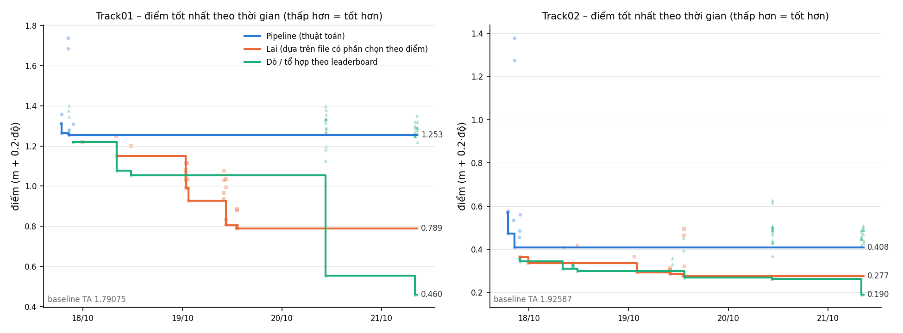

# 09 – Thống kê các lần nộp Kaggle (tự sinh bằng `tools/submission_stats.py`)

Phân loại theo trả lời của TA (20/10, xem [08 §12](08-gicp-va-scale.md)):

| Loại | Ý nghĩa | Dùng làm bài chấm? |
|---|---|---|
| **Pipeline** | chỉ thuật toán (GNSS + Kalman, NDT/GICP, gyro); tham số chọn theo điểm = chỉnh tham số bình thường | ✅ |
| **Lai** | thuật toán chạy trên nền một file có phần chọn theo điểm (vd. GICP khởi tạo từ yaw tổ hợp, vị trí Track02 tổ hợp) – có thể dựng lại sạch (`clean_*`) | ⚠️ phải dựng lại |
| **Leaderboard** | file dò (`probe_*`, `bump*`) và tổ hợp trọng số theo điểm (`*proj*`, `lb_*`, `corr_*`) | ❌ |

Điểm có `*` là điểm Kaggle hiện tại (chỉ 2 chữ số, Kaggle **cắt** bớt chứ không làm tròn); các điểm khác lấy từ log lúc nộp (5 chữ số). Giờ là UTC+8.

**Nhận xét.** Đường *Lai* (cam) là tiến bộ thuật toán thật (NDT → GICP → tỉ lệ mặt đường → demean → yaw gyro); nó chỉ "lai" vì chạy trên nền file có phần chọn theo điểm. Bản dựng lại sạch của file Lai tốt nhất (`clean_cfz1_tau7`, `clean_cfz2_tau15`, xem 08 §12) **chưa nộp**, dự kiến ~0.79 / ~0.28 – tức là đường Pipeline (xanh) sẽ xuống ngang đường cam. Khoảng cách tới đường xanh lá (0.46 / 0.19) là phần đến từ dò leaderboard, không được tính.

## Track01

| Loại | Số lần nộp | Tốt nhất | File |
|---|---|---|---|
| Pipeline (thuật toán) | 10 | 1.25338 | `phys_yawb_1` |
| Lai (dựa trên file có phần chọn theo điểm) | 29 | 0.78914 | `cfz1_tau7` |
| Dò / tổ hợp theo leaderboard | 37 | 0.46* | `corr_r1_1` |
| Khác | 1 | 5822.14* | `trial` |

**Các mốc cải thiện** (mỗi dòng là lần một loại đạt điểm tốt hơn; bỏ qua file dò `probe_*`/`bump*` vì chúng cố ý làm lệch):

| Thời gian | File | Loại | Điểm | Ghi chú |
|---|---|---|---|---|
| 16/10 09:36 | `kaggle_track1_result` | Pipeline | 602.39* | chạy code mẫu TA lần đầu (sai tỉ lệ) |
| 17/10 18:51 | `gnss_1` | Pipeline | 1.31094 | nội suy GNSS |
| 17/10 18:57 | `gnss_smooth_1` | Pipeline | 1.26235 |  |
| 17/10 20:28 | `rts_pos_gnssyaw_1` | Pipeline | 1.25992 | Kalman CTRV + RTS |
| 17/10 20:44 | `phys_yawb_1` | Pipeline | 1.25338 | + bỏ lệch yaw GNSS 0.42° |
| 17/10 21:44 | `yawproj_v1_1` | Dò / tổ hợp theo leaderboard | 1.21861 | tổ hợp yaw theo điểm |
| 17/10 23:55 | `startfix_on_v1_1` | Lai | 1.21871 |  |
| 18/10 08:08 | `ndt3c_s08_pos_1` | Lai | 1.15042 | NDT 3cameras tỉ lệ 0.8 |
| 18/10 08:08 | `posproj_v1_1` | Dò / tổ hợp theo leaderboard | 1.07618 | tổ hợp vị trí NDT theo điểm |
| 18/10 11:39 | `posproj_v2_1` | Dò / tổ hợp theo leaderboard | 1.05448 |  |
| 19/10 00:45 | `gicp_s08_pos_1` | Lai | 1.11701 |  |
| 19/10 00:48 | `gicp_ground_pos_1` | Lai | 1.06593 |  |
| 19/10 00:48 | `gicp_ground_all_pos_1` | Lai | 1.02813 | GICP + tỉ lệ mặt đường |
| 19/10 00:54 | `gicp_ground_pass2_pos_1` | Lai | 0.99283 | GICP lượt 2 |
| 19/10 01:24 | `pass2pos_bestyaw_1` | Lai | 0.99060 |  |
| 19/10 01:28 | `pass2dm_bestyaw_1` | Lai | 0.92775 | GICP 2 lượt + demean |
| 19/10 10:30 | `cfg1_tau15_al` | Lai | 0.80646 |  |
| 19/10 13:09 | `cfg1_tau10_al` | Lai | 0.79585 |  |
| 19/10 13:11 | `cfz1_tau10` | Lai | 0.79127 |  |
| 19/10 13:11 | `cfz1_tau7` | Lai | 0.78914 | + yaw gyro τ7 |
| 20/10 10:29 | `lb_posyaw_v1_1` | Dò / tổ hợp theo leaderboard | 0.55496 | tổ hợp 18 trường + 7 yaw |
| 21/10 08:00 | `corr_r1_1` | Dò / tổ hợp theo leaderboard | 0.46* | sửa từ dò dao động 0–6 |

Tất cả các lần nộp

| # | Thời gian | File | Loại | Điểm |
|---|---|---|---|---|
| 1 | 16/10 04:32 | `trial` | Khác | 5822.14* |
| 2 | 16/10 09:36 | `kaggle_track1_result` | Pipeline | 602.39* |
| 3 | 17/10 18:51 | `gnss_1` | Pipeline | 1.31094 |
| 4 | 17/10 18:57 | `gnss_smooth_1` | Pipeline | 1.26235 |
| 5 | 17/10 18:58 | `gnss_heading_1` | Pipeline | 1.35783 |
| 6 | 17/10 20:28 | `rts_pos_gnssyaw_1` | Pipeline | 1.25992 |
| 7 | 17/10 20:30 | `rts_pos_gnssyaw_dt-0.1_1` | Pipeline | 1.68409 |
| 8 | 17/10 20:31 | `rts_pos_gnssyaw_dt0.1_1` | Pipeline | 1.73784 |
| 9 | 17/10 20:35 | `probe_lat+0.5_1` | Dò / tổ hợp theo leaderboard | 1.37688 |
| 10 | 17/10 20:39 | `probe_lat-0.5_1` | Dò / tổ hợp theo leaderboard | 1.40077 |
| 11 | 17/10 20:40 | `probe_yaw+1_1` | Dò / tổ hợp theo leaderboard | 1.27676 |
| 12 | 17/10 20:43 | `probe_yaw-1_1` | Dò / tổ hợp theo leaderboard | 1.34505 |
| 13 | 17/10 20:44 | `phys_yawb_1` | Pipeline | 1.25338 |
| 14 | 17/10 20:45 | `phys_yawb_ndt_1` | Pipeline | 1.27855 |
| 15 | 17/10 21:39 | `lagyaw_pos_best_1` | Pipeline | 1.30875 |
| 16 | 17/10 21:44 | `yawproj_v1_1` | Dò / tổ hợp theo leaderboard | 1.21861 |
| 17 | 17/10 23:55 | `startfix_on_v1_1` | Lai | 1.21871 |
| 18 | 18/10 08:07 | `ndt3c_s10_pos_1` | Lai | 1.24807 |
| 19 | 18/10 08:08 | `ndt3c_s08_pos_1` | Lai | 1.15042 |
| 20 | 18/10 08:08 | `posproj_v1_1` | Dò / tổ hợp theo leaderboard | 1.07618 |
| 21 | 18/10 11:38 | `ndt3c_s085_pos_1` | Lai | 1.19954 |
| 22 | 18/10 11:39 | `posproj_v2_1` | Dò / tổ hợp theo leaderboard | 1.05448 |
| 23 | 19/10 00:45 | `gicp_s08_pos_1` | Lai | 1.11701 |
| 24 | 19/10 00:48 | `gicp_ground_pos_1` | Lai | 1.06593 |
| 25 | 19/10 00:48 | `gicp_ground_all_pos_1` | Lai | 1.02813 |
| 26 | 19/10 00:49 | `ndt_gicp_s08_pos_1` | Lai | 1.08265 |
| 27 | 19/10 00:50 | `gicp_ground_all_posyaw_1` | Lai | 1.03955 |
| 28 | 19/10 00:54 | `gicp_ground_pass2_pos_1` | Lai | 0.99283 |
| 29 | 19/10 01:06 | `gicp_ground_pass5_pos_1` | Lai | 1.11461 |
| 30 | 19/10 01:18 | `planar_ground_all_pos_1` | Lai | 1.03311 |
| 31 | 19/10 01:24 | `pass2pos_bestyaw_1` | Lai | 0.99060 |
| 32 | 19/10 01:28 | `pass2dm_bestyaw_1` | Lai | 0.92775 |
| 33 | 19/10 10:00 | `gicp_ground_pass3dm_bestyaw_1` | Lai | 0.93564 |
| 34 | 19/10 10:00 | `gicp_ground_pass4dm_bestyaw_1` | Lai | 0.96735 |
| 35 | 19/10 10:00 | `planar_pass2dm_bestyaw_1` | Lai | 1.02780 |
| 36 | 19/10 10:01 | `gicp_hood_sor_pos_1` | Lai | 1.07806 |
| 37 | 19/10 10:30 | `planar_clean_pos_1` | Lai | 1.03535 |
| 38 | 19/10 10:30 | `cfg1_tau15_al` | Lai | 0.80646 |
| 39 | 19/10 10:31 | `cfg1_tau30_al` | Lai | 0.83296 |
| 40 | 19/10 10:31 | `plane_icp_ground_pos_1` | Lai | 0.99504 |
| 41 | 19/10 13:08 | `plane_icp_pass2dm_cfyaw_1` | Lai | 0.87976 |
| 42 | 19/10 13:08 | `plane_icp_pass2plain_cfyaw_1` | Lai | 0.88523 |
| 43 | 19/10 13:09 | `cfg1_tau10_al` | Lai | 0.79585 |
| 44 | 19/10 13:09 | `cfz1_tau15_al` | Lai | 0.80411 |
| 45 | 19/10 13:09 | `cfg1_tau15` | Lai | 0.80359 |
| 46 | 19/10 13:11 | `cfz1_tau10` | Lai | 0.79127 |
| 47 | 19/10 13:11 | `cfz1_tau7` | Lai | 0.78914 |
| 48 | 20/10 10:29 | `lb_posyaw_v1_1` | Dò / tổ hợp theo leaderboard | 0.55496 |
| 49 | 20/10 10:30 | `probe_x0_1` | Dò / tổ hợp theo leaderboard | 1.32969 |
| 50 | 20/10 10:30 | `probe_x1_1` | Dò / tổ hợp theo leaderboard | 1.40012 |
| 51 | 20/10 10:31 | `probe_x2_1` | Dò / tổ hợp theo leaderboard | 1.26597 |
| 52 | 20/10 10:31 | `probe_x3_1` | Dò / tổ hợp theo leaderboard | 1.12730 |
| 53 | 20/10 10:31 | `probe_x4_1` | Dò / tổ hợp theo leaderboard | 1.18208 |
| 54 | 20/10 10:32 | `probe_x5_1` | Dò / tổ hợp theo leaderboard | 1.33500 |
| 55 | 20/10 10:32 | `probe_x6_1` | Dò / tổ hợp theo leaderboard | 1.31574 |
| 56 | 20/10 10:32 | `probe_y0_1` | Dò / tổ hợp theo leaderboard | 1.33648 |
| 57 | 20/10 10:33 | `probe_y1_1` | Dò / tổ hợp theo leaderboard | 1.19880 |
| 58 | 20/10 10:33 | `probe_y2_1` | Dò / tổ hợp theo leaderboard | 1.28668 |
| 59 | 20/10 10:34 | `probe_y3_1` | Dò / tổ hợp theo leaderboard | 1.38082 |
| 60 | 20/10 10:34 | `probe_y4_1` | Dò / tổ hợp theo leaderboard | 1.35677 |
| 61 | 20/10 10:34 | `probe_y5_1` | Dò / tổ hợp theo leaderboard | 1.27174 |
| 62 | 20/10 10:35 | `probe_y6_1` | Dò / tổ hợp theo leaderboard | 1.29067 |
| 63 | 21/10 08:00 | `corr_r1_1` | Dò / tổ hợp theo leaderboard | 0.46* |
| 64 | 21/10 08:00 | `probe_x7_1` | Dò / tổ hợp theo leaderboard | 1.29* |
| 65 | 21/10 08:00 | `probe_x8_1` | Dò / tổ hợp theo leaderboard | 1.25* |
| 66 | 21/10 08:01 | `probe_x9_1` | Dò / tổ hợp theo leaderboard | 1.25* |
| 67 | 21/10 08:01 | `probe_x10_1` | Dò / tổ hợp theo leaderboard | 1.32* |
| 68 | 21/10 08:01 | `probe_x11_1` | Dò / tổ hợp theo leaderboard | 1.30* |
| 69 | 21/10 08:02 | `probe_x12_1` | Dò / tổ hợp theo leaderboard | 1.25* |
| 70 | 21/10 08:02 | `probe_x13_1` | Dò / tổ hợp theo leaderboard | 1.27* |
| 71 | 21/10 08:30 | `probe_y7_1` | Dò / tổ hợp theo leaderboard | 1.35* |
| 72 | 21/10 08:30 | `probe_y8_1` | Dò / tổ hợp theo leaderboard | 1.29* |
| 73 | 21/10 08:30 | `probe_y9_1` | Dò / tổ hợp theo leaderboard | 1.32* |
| 74 | 21/10 08:31 | `probe_y10_1` | Dò / tổ hợp theo leaderboard | 1.28* |
| 75 | 21/10 08:31 | `probe_y11_1` | Dò / tổ hợp theo leaderboard | 1.29* |
| 76 | 21/10 08:31 | `probe_y12_1` | Dò / tổ hợp theo leaderboard | 1.22* |
| 77 | 21/10 08:32 | `probe_y13_1` | Dò / tổ hợp theo leaderboard | 1.26* |

## Track02

| Loại | Số lần nộp | Tốt nhất | File |
|---|---|---|---|
| Pipeline (thuật toán) | 10 | 0.40778 | `rts_heading_2` |
| Lai (dựa trên file có phần chọn theo điểm) | 16 | 0.27654 | `cfz2_tau15` |
| Dò / tổ hợp theo leaderboard | 48 | 0.19* | `corr_r1_2` |
| Khác | 1 | – |  |

**Các mốc cải thiện** (mỗi dòng là lần một loại đạt điểm tốt hơn; bỏ qua file dò `probe_*`/`bump*` vì chúng cố ý làm lệch):

| Thời gian | File | Loại | Điểm | Ghi chú |
|---|---|---|---|---|
| 17/10 18:52 | `gnss_2` | Pipeline | 0.57111 | nội suy GNSS |
| 17/10 19:00 | `gnss_heading_2` | Pipeline | 0.47281 | yaw = hướng chạy |
| 17/10 20:28 | `rts_heading_2` | Pipeline | 0.40778 | Kalman CTRV + RTS |
| 17/10 21:44 | `yawproj_v1_2` | Dò / tổ hợp theo leaderboard | 0.35696 |  |
| 17/10 21:48 | `curv1.5_on_proj_2` | Lai | 0.36280 |  |
| 17/10 21:50 | `yawproj_v3_2` | Dò / tổ hợp theo leaderboard | 0.34530 |  |
| 17/10 23:54 | `startfix_on_v3_2` | Lai | 0.33504 | yaw khởi hành bằng gyro |
| 18/10 08:07 | `yawproj_v4_2` | Dò / tổ hợp theo leaderboard | 0.30984 |  |
| 18/10 11:39 | `posyaw_v2_2` | Dò / tổ hợp theo leaderboard | 0.29887 |  |
| 19/10 02:01 | `cf_tau5_2` | Lai | 0.29268 | yaw gyro τ5 |
| 19/10 10:02 | `cfg2_tau15_al` | Lai | 0.28743 |  |
| 19/10 13:12 | `cfz2_tau15` | Lai | 0.27654 | yaw gyro τ15 |
| 19/10 13:25 | `posproj_t2_v1_2` | Dò / tổ hợp theo leaderboard | 0.26849 | tổ hợp vị trí theo điểm |
| 20/10 10:35 | `lb_posyaw_v1_2` | Dò / tổ hợp theo leaderboard | 0.26291 | tổ hợp |
| 21/10 08:03 | `corr_r1_2` | Dò / tổ hợp theo leaderboard | 0.19* | sửa từ dò dao động 0–6 |

Tất cả các lần nộp

| # | Thời gian | File | Loại | Điểm |
|---|---|---|---|---|
| 1 | 17/10 18:52 | `gnss_2` | Pipeline | 0.57111 |
| 2 | 17/10 18:59 | `gnss_smooth_2` | Pipeline | 0.57811 |
| 3 | 17/10 18:59 | `gnss_heading_1` | Khác | lỗi |
| 4 | 17/10 19:00 | `gnss_heading_2` | Pipeline | 0.47281 |
| 5 | 17/10 20:18 | `fusion_s9r4_headingyaw_2` | Pipeline | 0.53520 |
| 6 | 17/10 20:28 | `rts_heading_2` | Pipeline | 0.40778 |
| 7 | 17/10 20:30 | `rts_heading_dt-0.1_2` | Pipeline | 1.27503 |
| 8 | 17/10 20:31 | `rts_heading_dt0.1_2` | Pipeline | 1.37861 |
| 9 | 17/10 21:38 | `lagyaw_pos_best_2` | Pipeline | 0.45496 |
| 10 | 17/10 21:41 | `yawtau0.75_pos_best_2` | Pipeline | 0.48625 |
| 11 | 17/10 21:44 | `yawproj_v1_2` | Dò / tổ hợp theo leaderboard | 0.35696 |
| 12 | 17/10 21:48 | `curv1.5_on_proj_2` | Lai | 0.36280 |
| 13 | 17/10 21:49 | `gnssyaw_pos_rts_2` | Pipeline | 0.56160 |
| 14 | 17/10 21:50 | `yawproj_v3_2` | Dò / tổ hợp theo leaderboard | 0.34530 |
| 15 | 17/10 23:54 | `startfix_on_v3_2` | Lai | 0.33504 |
| 16 | 18/10 08:07 | `yawproj_v4_2` | Dò / tổ hợp theo leaderboard | 0.30984 |
| 17 | 18/10 08:31 | `ndt3c_s10_pos_2` | Lai | 0.40544 |
| 18 | 18/10 10:24 | `bump9_0_2` | Dò / tổ hợp theo leaderboard | 0.32253 |
| 19 | 18/10 10:28 | `bump9_3_2` | Dò / tổ hợp theo leaderboard | 0.33354 |
| 20 | 18/10 10:31 | `bump9_5_2` | Dò / tổ hợp theo leaderboard | 0.33383 |
| 21 | 18/10 10:31 | `bump9_6_2` | Dò / tổ hợp theo leaderboard | 0.34151 |
| 22 | 18/10 10:32 | `bump9_7_2` | Dò / tổ hợp theo leaderboard | 0.33223 |
| 23 | 18/10 10:36 | `bump9_1_2` | Dò / tổ hợp theo leaderboard | 0.32873 |
| 24 | 18/10 10:36 | `bump9_2_2` | Dò / tổ hợp theo leaderboard | 0.33664 |
| 25 | 18/10 10:37 | `bump9_4_2` | Dò / tổ hợp theo leaderboard | 0.32498 |
| 26 | 18/10 10:37 | `bump9_8_2` | Dò / tổ hợp theo leaderboard | 0.32382 |
| 27 | 18/10 11:38 | `ndt3c_s08_pos_2` | Lai | 0.41824 |
| 28 | 18/10 11:39 | `posyaw_v2_2` | Dò / tổ hợp theo leaderboard | 0.29887 |
| 29 | 19/10 01:22 | `gicp_dm_w05_on_best_2` | Lai | 0.36530 |
| 30 | 19/10 02:01 | `cf_tau5_2` | Lai | 0.29268 |
| 31 | 19/10 10:01 | `cfg2_tau5_al` | Lai | 0.30531 |
| 32 | 19/10 10:01 | `cfg2_tau5` | Lai | 0.29756 |
| 33 | 19/10 10:02 | `cfg2_tau15_al` | Lai | 0.28743 |
| 34 | 19/10 10:02 | `cfg2_tau2_al` | Lai | 0.31258 |
| 35 | 19/10 10:32 | `probe_cf5_yaw+0.5_2` | Dò / tổ hợp theo leaderboard | 0.33197 |
| 36 | 19/10 10:32 | `probe_cf5_yaw-0.5_2` | Dò / tổ hợp theo leaderboard | 0.35944 |
| 37 | 19/10 13:12 | `cfz2_tau15` | Lai | 0.27654 |
| 38 | 19/10 13:13 | `cfz2_tau10` | Lai | 0.27949 |
| 39 | 19/10 13:13 | `cfz2_tau30` | Lai | 0.28034 |
| 40 | 19/10 13:15 | `probe_lat+0.3_2` | Dò / tổ hợp theo leaderboard | 0.45373 |
| 41 | 19/10 13:16 | `probe_lat-0.3_2` | Dò / tổ hợp theo leaderboard | 0.39579 |
| 42 | 19/10 13:23 | `plane_icp_cf_dm_2` | Lai | 0.49383 |
| 43 | 19/10 13:23 | `gicp_cf_dm_2` | Lai | 0.46400 |
| 44 | 19/10 13:24 | `ndt3c_cf_dm_2` | Lai | 0.32011 |
| 45 | 19/10 13:25 | `posproj_t2_v1_2` | Dò / tổ hợp theo leaderboard | 0.26849 |
| 46 | 20/10 10:35 | `lb_posyaw_v1_2` | Dò / tổ hợp theo leaderboard | 0.26291 |
| 47 | 20/10 10:36 | `probe_x0_2` | Dò / tổ hợp theo leaderboard | 0.61644 |
| 48 | 20/10 10:36 | `probe_x1_2` | Dò / tổ hợp theo leaderboard | 0.43173 |
| 49 | 20/10 10:36 | `probe_x2_2` | Dò / tổ hợp theo leaderboard | 0.43041 |
| 50 | 20/10 10:37 | `probe_x3_2` | Dò / tổ hợp theo leaderboard | 0.50500 |
| 51 | 20/10 10:37 | `probe_x4_2` | Dò / tổ hợp theo leaderboard | 0.46752 |
| 52 | 20/10 10:38 | `probe_x5_2` | Dò / tổ hợp theo leaderboard | 0.36959 |
| 53 | 20/10 10:38 | `probe_x6_2` | Dò / tổ hợp theo leaderboard | 0.44091 |
| 54 | 20/10 10:38 | `probe_y0_2` | Dò / tổ hợp theo leaderboard | 0.62749 |
| 55 | 20/10 10:39 | `probe_y1_2` | Dò / tổ hợp theo leaderboard | 0.50550 |
| 56 | 20/10 10:39 | `probe_y2_2` | Dò / tổ hợp theo leaderboard | 0.49559 |
| 57 | 20/10 10:39 | `probe_y3_2` | Dò / tổ hợp theo leaderboard | 0.49202 |
| 58 | 20/10 10:40 | `probe_y4_2` | Dò / tổ hợp theo leaderboard | 0.48105 |
| 59 | 20/10 10:40 | `probe_y5_2` | Dò / tổ hợp theo leaderboard | 0.50504 |
| 60 | 20/10 10:41 | `probe_y6_2` | Dò / tổ hợp theo leaderboard | 0.49073 |
| 61 | 21/10 08:03 | `corr_r1_2` | Dò / tổ hợp theo leaderboard | 0.19* |
| 62 | 21/10 08:03 | `probe_x7_2` | Dò / tổ hợp theo leaderboard | 0.48* |
| 63 | 21/10 08:03 | `probe_x8_2` | Dò / tổ hợp theo leaderboard | 0.45* |
| 64 | 21/10 08:04 | `probe_x9_2` | Dò / tổ hợp theo leaderboard | 0.45* |
| 65 | 21/10 08:04 | `probe_x10_2` | Dò / tổ hợp theo leaderboard | 0.49* |
| 66 | 21/10 08:04 | `probe_x11_2` | Dò / tổ hợp theo leaderboard | 0.42* |
| 67 | 21/10 08:05 | `probe_x12_2` | Dò / tổ hợp theo leaderboard | 0.45* |
| 68 | 21/10 08:05 | `probe_x13_2` | Dò / tổ hợp theo leaderboard | 0.46* |
| 69 | 21/10 08:32 | `probe_y7_2` | Dò / tổ hợp theo leaderboard | 0.47* |
| 70 | 21/10 08:32 | `probe_y8_2` | Dò / tổ hợp theo leaderboard | 0.49* |
| 71 | 21/10 08:33 | `probe_y9_2` | Dò / tổ hợp theo leaderboard | 0.50* |
| 72 | 21/10 08:33 | `probe_y10_2` | Dò / tổ hợp theo leaderboard | 0.49* |
| 73 | 21/10 08:34 | `probe_y11_2` | Dò / tổ hợp theo leaderboard | 0.51* |
| 74 | 21/10 08:34 | `probe_y12_2` | Dò / tổ hợp theo leaderboard | 0.43* |
| 75 | 21/10 08:35 | `probe_y13_2` | Dò / tổ hợp theo leaderboard | 0.44* |

