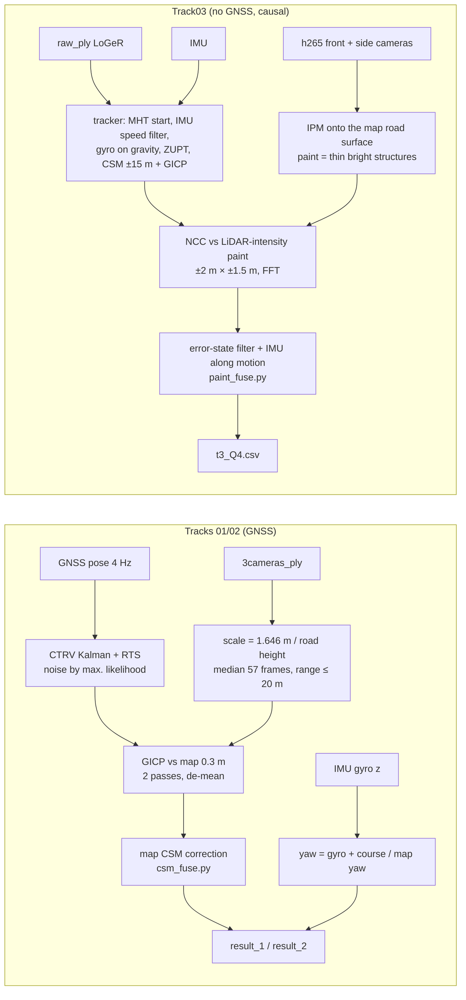

# Presentation outline – SDC 2026 Midterm01 (Localization), team "11"

Bộ slide đầy đủ, không giới hạn thời gian. **Slide viết tiếng Anh, lời thoại (speaker notes) tiếng Việt.**
Soạn ngày 25/10/2026 từ repo `mochihat/SDC-midterm-1-` (97 commit), nhật ký `docs/nhat-ky/01–13`, `CLAUDE.md`,
log của bot (`~/kaggle-sdc-bot/bot.log`, 261 lần nộp có điểm) và các file kết quả trong `src/localization/result/`.

**Quy ước**
- Mọi con số đều có nguồn, ghi trong ngoặc vuông dạng `[nk 08 §3]` (= `docs/nhat-ky/08-…md` mục 3), `[bot.log]`, `[code: file]`.
- `[CẦN ĐIỀN: …]` = repo/log không có thông tin này, bạn phải tự điền. Không có con số nào được đoán.
- Hình: phần lớn đã vẽ sẵn bằng `python3 docs/report/make_outline_figs.py` (chạy trên máy, cần numpy + matplotlib, đọc file
  kết quả và bản đồ trên máy) → `docs/report/fig/outline/*.png`. Hình cũ đã có sẵn trong `docs/nhat-ky/fig/` và `docs/report/fig/`.
  Bảng điểm gộp của mọi lần nộp: `docs/report/fig/outline/submissions_all.csv` (do script tạo từ `bot.log` + 8 lần nộp tay ngày 16–17/10).
- Điểm Kaggle: thấp hơn là tốt hơn. Từ 21/10 Kaggle chỉ hiện 2 chữ số **cắt bớt** (không làm tròn); điểm 5 chữ số là điểm lúc nộp trước 21/10.

**Ba điều cần trình bày trung thực (đọc trước khi dùng outline)**
1. **Track03**: bài cuối (`t3_Q4`) là output trực tiếp của pipeline **nhân quả** (hàng k chỉ dùng dữ liệu ≤ k), không hậu xử lý,
   không sửa tay; chạy lại được bằng `tools/run_track3_paint.sh`. Tham số được chỉnh theo điểm public – người dùng báo TA cho phép
   ("chỉ cấm sửa trực tiếp file kết quả") [nk 12 §9]. Lưu ý: tham số mặc định trong `run_track3_paint.sh` hiện vẫn là của `t3_PA2`;
   muốn ra đúng `t3_Q4` phải truyền `SIDE=1 PASSES=1 FUSE=… FUSE_EXTRA=…` (Phụ lục C). Đã kiểm chứng 25/10 23:40: đo lại toàn bộ
   (camera trước + bên) rồi lọc bằng đúng các cờ đó → **trùng từng byte với `t3_Q4.csv`**. Nên đặt cấu hình Q4 làm mặc định của script trước khi nộp E3 `[CẦN ĐIỀN]`.
2. **Track01/02**: KHÔNG thể khẳng định "causal, không post-processing". Pipeline sạch dùng **Kalman + RTS smoother (làm mượt hai
   chiều)** và làm mượt Gauss có tâm (dùng cả frame tương lai); bài tốt nhất (0.36 / 0.11) là **file dò bảng điểm** (leaderboard probing).
   Theo người dùng, TA xác nhận trên lớp 23/10 rằng Track01/02 chấm theo public toàn bộ nên được dò [CLAUDE.md §2; nk 11 "Luật"], trong khi
   văn bản luật 10/22 ghi "Offline trajectory corrections and leaderboard-based fitting are strictly prohibited" + "Causal localization only"
   [nk 10 "Dò điểm như một chiến thuật"]. Có một pipeline nhân quả cho Track01/02 (`tools/run_causal_pipeline.sh`) nhưng **chưa nộp**
   [nk 11]. → `[CẦN ĐIỀN: xác nhận lại với TA bằng văn bản cách chấm Track01/02 và file sẽ chọn "Use for Final Score"]`.
3. **Vai trò của AI**: đội có 1 thành viên; code và phân tích phần lớn do trợ lý lập trình Claude Code viết và chạy theo chỉ dẫn,
   mọi đợt nộp Kaggle đều do người dùng duyệt. Slide nói "solo, AI-assisted" – phân công cụ thể `[CẦN ĐIỀN]` (slide 6.4).

---

# PHẦN 1 – MỞ ĐẦU

## Slide 1.1 – Title
**Title:** Localizing a car against a LiDAR map with camera point clouds, road paint and the IMU

**Content**
- SDC 2026 · Midterm01 · Localization (Kaggle, 3 tracks)
- Team **11** (Kaggle team name) · group_id `[CẦN ĐIỀN: group_id chính thức của môn nếu khác "11"]`
- Member: `[CẦN ĐIỀN: họ tên]` · student ID 114550202 · solo, AI-assisted (Claude Code)
- Final standing (public leaderboard, 25/10 22:30): Track01 **rank 1** (0.36), Track02 **rank 1** (0.11), Track03 **rank 2** (0.28) [bot.py status]

**Figure:** none (title slide), or `docs/report/fig/outline/trajectory_on_map_t3.png` as background.

**Speaker notes (VI):**
Xin chào thầy cô và các bạn, em là đội 11, làm một mình. Bài của em là định vị xe – tức ước lượng x, y và góc yaw của xe ở từng
frame camera – bằng cách đặt các point cloud dựng từ ảnh vào một bản đồ LiDAR có sẵn. Em có dùng trợ lý lập trình AI là Claude Code
để viết code và chạy thí nghiệm; mọi quyết định và mọi lần nộp Kaggle là do em duyệt, và toàn bộ quá trình được ghi trong nhật ký của
repo. Kết quả hiện tại: hạng 1 ở Track01 và Track02, hạng 2 ở phần public của Track03. Bài thuyết trình sẽ đi theo 6 phần: bài toán,
pipeline, chiến thuật thi đấu, các lỗi đã gặp và cách sửa, chiến thuật riêng từng track, và kết quả.

## Slide 1.2 – The problem
**Title:** Problem: one pose per camera frame, scored in metres and degrees

**Content**
- Input per track: image point cloud per frame (`raw_ply`: LoGeR, front camera; `3cameras_ply`: MapAnything, 3 cameras), LiDAR map
  `map.pcd` (x y z intensity), `init_guess.txt` (noisy 4×4 start pose), rosbag `TrackN.db3` (IMU 100 Hz, 3 h265 camera streams,
  GNSS pose on Tracks 01/02 only) [nk 01 §2]
- Output: CSV `idx, x, y, yaw` (yaw in radians), one row per frame [nk 01 §1]
- Metric: **E = RMSE(Δp) + 0.2 · RMSE(Δθ)** (m, deg) → 1° of yaw costs as much as 0.2 m [nk 01 §1]
- Rules 10/22 for Track03: causal only (current + past frames), no post-processing, TA reruns the code, violation = 0 [nk 11]

**Figure:** simple block "inputs → localizer → CSV", or the formula large. (No data figure needed.)

**Speaker notes (VI):**
Đầu vào của mỗi track gồm point cloud dựng từ ảnh cho từng frame, bản đồ LiDAR có cả cường độ phản xạ, một pose ban đầu có cộng
nhiễu, và rosbag chứa IMU 100 Hz, ba luồng video camera nén h265, và ở Track01/02 có thêm topic pose GNSS. Đầu ra là một file CSV
mỗi frame một dòng: x, y và yaw theo radian. Điểm là RMSE vị trí cộng 0,2 lần RMSE yaw tính bằng độ, nghĩa là sai 1 độ yaw bị phạt
bằng sai 20 cm vị trí – nên yaw quan trọng không kém vị trí. Với Track03 có luật riêng từ ngày 22/10: chỉ được dùng frame hiện tại và
quá khứ, không làm mượt ngược, và TA sẽ chạy lại code.

## Slide 1.3 – Data: two kinds of image point cloud
**Title:** Two image point clouds, neither in metres

**Content**

| | `raw_ply` (LoGeR) | `3cameras_ply` (MapAnything) |
|---|---|---|
| Cameras | front only | front + front-left + front-right |
| Points / frame | ~20–41 k, ASCII, RGB | ~330 k, binary, frame FLU |
| Scale | arbitrary: road ~0.18 units below the camera → ×≈9 | near metric: road 2.06 m below → ×0.8 fits |
| Size (Track01) | 3011 files, 5.09 GB | 3011 files, 14.75 GB |
| Available on Track03 | yes | **no** |
[nk 01 §2; nk 02 §3, §8; nk 11]

- Both are distorted: per-frame scale varies 5–7 %, depth error grows with range [nk 02 §3; nk 10 T2]
- Map: Track01 59.5 M points (2.70 GB ASCII), Track02 50.9 M, Track03 57 M [nk 01; nk 02 §4; nk 11]

**Figure:** `docs/nhat-ky/fig/t5_scale_x3.png` (left panel: frame 40 at the GNSS pose, cloud ×3 vs ×9.27).

**Speaker notes (VI):**
Có hai loại point cloud từ ảnh. `raw_ply` do mô hình LoGeR dựng từ một camera trước, mỗi frame vài chục nghìn điểm, và không có đơn vị:
mặt đường chỉ nằm khoảng 0,18 đơn vị dưới camera, trong khi camera thật cao khoảng 1,6 m – nên phải nhân khoảng 9 lần. `3cameras_ply`
do MapAnything dựng từ ba camera, dày hơn mười lần và gần đúng mét. Điểm quan trọng: Track03 chỉ có `raw_ply`, không có `3cameras_ply`.
Cả hai đều bị méo: tỉ lệ dao động 5–7 % giữa các frame và độ sâu sai nhiều hơn ở xa. Hình bên trái cho thấy cùng một frame ở tỉ lệ 3
(baseline) và tỉ lệ đo được 9,27 – chênh nhau rất lớn.

## Slide 1.4 – The three tracks
**Title:** Three tracks, three difficulties

**Content**

| | Track01 | Track02 | Track03 |
|---|---|---|---|
| Frames | 3011 | 3299 | 3142 |
| GNSS | yes (4 Hz), jittery 0.142 m | yes, smooth 0.052 m | **no** |
| Scored on | public = whole track (TA) | public = whole track (TA) | **private ≈ 87 %** (public ≈ first 13 %) |
| Particular | trees/buildings on 74 % of the road, 11 GNSS jumps | 13 s standstill at start, init yaw off 14.85° | 43 s red light = 44 % of private frames; 88° left turn; final stop |
| TA baseline | 1.79075 | 1.92587 | private ≤ 1.40 |
[nk 01 §1; nk 02 §1–2; nk 10 T11; nk 12 §8; CLAUDE.md]

- Public share of Track03: the rules say "first 5–40 %"; the 13 % (frames 0–408) is the figure the user reported `[CẦN ĐIỀN: xác nhận nguồn con số 13 %]`

**Figure:** `docs/report/fig/outline/t3_segments.png` (Track03 speed with public / red light / turn / final stop shaded).

**Speaker notes (VI):**
Ba track có độ khó khác nhau. Track01 và Track02 có GNSS, nhưng GNSS của Track01 giật gấp ba Track02 vì đường có cây và nhà cao hai
bên ở 74 % quãng đường, với 11 bước nhảy. Track02 bắt đầu bằng 13 giây đứng yên và pose ban đầu lệch gần 15 độ. Track03 không có GNSS
và được chấm ở phần private – khoảng 87 % số frame. Hình dưới là tốc độ xe ở Track03: phần public chỉ là đoạn đầu; phần private gồm
một lần đứng đèn đỏ 43 giây, chiếm 44 % số frame private, rồi xe chạy lại, rẽ trái 88 độ và dừng ở cuối. Vì vậy chiến thuật Track03
phải nhắm vào những đoạn mà bảng điểm public không thấy.

## Slide 1.5 – Challenges
**Title:** What makes it hard

**Content**
- **Wrong scale in the template** (`ply_scale = 3`, real ≈ 9) → NDT drifts 91 m / 110 m [nk 03 §1]
- **Distorted AI clouds**: on a synthetic "perfect" cloud GICP errs 5–8 mm; on the real cloud 0.79 m per frame and 2.7–2.9° yaw →
  the error comes from the cloud, not the matcher [nk 10 T2]
- **Noisy start**: init_guess off 0.55 m / 2.0° (T1), 0.65 m / 14.85° (T2), roll/pitch ~15° (T3) [nk 02 §2; nk 11]
- **GNSS quirks**: GNSS yaw is derived from positions, lags 1.1–1.4 s and freezes when stopped [nk 02 §6–7]
- **No GNSS on Track03**: scan-to-scan odometry of LoGeR is 0.12–1.16 × the true distance [nk 12 §1]
- **Dynamic objects**: not measured separately in this project `[CẦN ĐIỀN nếu muốn nêu: không có số liệu trong repo]`; what we do: map
  matching uses only the static map, the camera-paint extractor keeps only structures narrower than 0.7 m (cars removed) [code: paint_bev.py]

**Figure:** `docs/nhat-ky/fig/t2_synthetic.png` (GICP error: perfect cloud vs simulated errors vs the real cloud).

**Speaker notes (VI):**
Có năm khó khăn chính. Thứ nhất, code mẫu dùng sai tỉ lệ point cloud nên NDT trôi hàng trăm mét. Thứ hai – đây là phát hiện quan trọng
nhất – chính point cloud do AI dựng bị méo: em tạo point cloud "hoàn hảo" từ bản đồ LiDAR thì GICP chỉ sai 5–8 mm, còn với point cloud
thật thì mỗi frame sai khoảng 0,8 m và gần 3 độ yaw. Nghĩa là đổi thuật toán khớp không giải quyết được; phải xử lý đầu vào. Thứ ba,
pose ban đầu có nhiễu lớn. Thứ tư, yaw của GNSS thật ra được tính từ vị trí nên bị trễ hơn 1 giây và đứng yên khi xe dừng. Thứ năm,
Track03 không có GNSS và odometry từ point cloud rất thất thường. Về vật thể động, em không đo riêng; bản đồ là tĩnh và bộ tách vạch sơn
loại các vật rộng hơn 0,7 m như ô tô.

---

# PHẦN 2 – PIPELINE TỔNG THỂ

## Slide 2.1 – Full pipeline (all tracks)
**Title:** Pipeline overview

**Content (diagram, Mermaid – vẽ lại trong PowerPoint hoặc render bằng mermaid-cli):**



**Figure:** the diagram above. Old diagram (Vietnamese, 19/10, only Track01/02): `docs/report/fig/pipeline.png`.

**Speaker notes (VI):**
Đây là toàn bộ pipeline. Với Track01/02, GNSS cho khung toạ độ: em đưa GNSS qua bộ lọc Kalman mô hình chuyển động xe CTRV cùng bộ làm
mượt RTS, rồi dùng point cloud ba camera – đã chỉnh tỉ lệ theo độ cao mặt đường và cắt ở 20 m – khớp GICP với bản đồ để sửa vị trí,
cộng thêm một bước khớp lưới với bản đồ (CSM). Yaw lấy từ con quay hồi chuyển cho phần nhanh và từ hướng chạy hoặc bản đồ cho phần
chậm. Với Track03 không có GNSS nên có hai tầng: một bộ bám nhân quả dùng point cloud LoGeR và IMU; rồi một tầng dùng ảnh camera để
khớp vạch sơn trên đường với vạch sơn trong cường độ bản đồ LiDAR, lọc bằng một bộ lọc sai số trạng thái có chuyển động theo IMU.

## Slide 2.2 – What we added to the template
**Title:** Template vs our contribution

**Content**
- **Template** (`localization.cpp`, `map_modified.cpp`): NDT (PCL), `ply_scale` 3, input voxel 0.3 m, map voxel 1 m, submap ±100 m,
  NDT resolution 8 m / step 0.8 / ε 0.05 / 30 iterations, next frame starts at the previous pose, start from `init_guess`
  [code: git show 65d10cb:…/localization.h]
- **Our C++ changes** (`localization.cpp/.h`, ~130 changed lines): per-frame prior file, gating of NDT corrections (3 m / 5°), `frame_stride`,
  `start_frame` (10 parallel chunks), `max_input_range`, per-frame debug CSV [git diff 65d10cb HEAD]
- **Our Python toolchain** (59 files in `tools/`, ~6 600 lines): scale from road height, CTRV Kalman/RTS with ML noise, GICP pipeline
  (`small_gicp`), yaw complementary filter, map CSM + map yaw, causal GNSS-free tracker (MHT, speed filter, ZUPT, CSM), road-paint
  matching (h265 decode, fisheye IPM, FFT NCC, error-state filter with IMU motion), validation tools (synthetic GICP, error budget, map
  fit), leaderboard analysis tools, Kaggle bot [ls tools; git log]
- Every submission reproducible: 34/34 early files byte-identical (`tools/reproduce_submissions.sh`), clean pipeline one command
  (`tools/run_clean_pipeline.sh`), Track03 from the raw bag (`tools/run_track3_paint.sh`) [nk 07; CLAUDE.md §4; nk 13 §2]

**Figure:** two-column table "template | ours" (no data figure).

**Speaker notes (VI):**
Phần đóng góp riêng so với code mẫu. Code mẫu là một vòng NDT của PCL: nhân point cloud với 3, khớp với bản đồ giảm mẫu 1 m trong vùng
±100 m, mỗi frame bắt đầu từ pose frame trước. Em sửa node C++ để nhận một prior cho từng frame, loại các kết quả NDT nhảy quá xa, chạy
cách frame và chia 10 đoạn song song, và ghi file debug. Nhưng phần lớn đóng góp là bộ công cụ Python: ước lượng tỉ lệ từ độ cao mặt
đường, bộ lọc Kalman với nhiễu ước lượng bằng maximum likelihood, pipeline GICP, bộ lọc yaw, bộ bám không GNSS cho Track03, và cuối cùng
là khớp vạch sơn từ ảnh camera – phần này không có trong code mẫu và là thứ đưa Track03 từ 0,80 xuống 0,28. Mọi file đã nộp đều tạo lại
được bằng script.

## Slide 2.3 – Map processing
**Title:** Map: voxel size, crop and derived rasters

**Content**
- Template: VoxelGrid 1 m (T1 59.5 M → 496 909 points; T2 50.9 M → 297 890) cached as `map_downsampled_1m.pcd` (read 58 s → seconds)
  [nk 01 §4; nk 02 §4]
- GICP map: **0.3 m voxel** (`tools/map_voxel.py`); T3 57 M → 1.55 M points [nk 08 §1; nk 11]
- Why 0.3 m: one-parameter sweep 0.2 / 0.3 / 0.5 m changes the GICP noise by ≤ 0.04 m; 0.2 m is 3× slower [nk 10 T4]
- Crop: template submap ±100 m (NDT runs used ±60 m); GICP uses image points ≤ 20 m (sweep 10/15/20/30/40 m) [nk 03 §4; nk 10 T4/T6]
- Derived maps: (1) **likelihood field** of map points 0.4–3 m above ground for CSM (Track03) [nk 12 §2]; (2) **road-paint rasters**:
  ground height 0.5 m cells (10th percentile), road intensity 0.1 m cells, paint = white top-hat 0.7 m; corridor of 30 m around the
  prior (frame k only reads the map within ~25 m of the prior at k) [nk 13 §2; code: paint_map.py]

**Figure:** a crop of the Track03 paint raster next to the camera image – reuse `docs/report/fig/paint_matching.png` (bottom panels show
map paint in blue). Suggested new figure (not drawn): T4 sweep bars from `docs/nhat-ky/data/t4_sweep.csv` (valid %, noise along/lateral).

**Speaker notes (VI):**
Bản đồ gốc có khoảng 50–60 triệu điểm. Code mẫu giảm mẫu 1 m và lưu cache để không phải đọc lại file ASCII 2,7 GB. Cho GICP em dùng voxel
0,3 m; em đã quét 0,2 / 0,3 / 0,5 m, mỗi lần chỉ đổi một tham số, và thấy kích thước voxel gần như không ảnh hưởng – 0,2 m chỉ chậm hơn ba
lần. Thứ ảnh hưởng mạnh là tầm của point cloud ảnh: cắt ở 20 m tốt nhất. Ngoài ra em dựng hai loại bản đồ phụ: một trường xác suất từ các
điểm cao 0,4–3 m (cột, tường) cho bước khớp lưới, và các raster vạch sơn từ cường độ LiDAR cho bước khớp camera ở Track03.

## Slide 2.4 – Image point-cloud processing
**Title:** Image point clouds: scale, range, filters

**Content**
- **Scale per frame** = 1.646 m / road height under the camera, trailing median of 57 frames (~2 s); road height 1.73–2.27 between
  segments → a fixed 0.8 is wrong by a few % [nk 08 §1]; on Track03 the median is causal (past frames only) [nk 11]
- **Range ≤ 20 m**: far points are the most distorted (T2 synthetic); Kaggle T1 0.80 → **0.63** [nk 10 T2, T6]
- **Hood mask**: tested on `3cameras_ply` – only 0.5–2 % of points in the hood region (MapAnything already removes it), GICP change 0.09 m
  → not used for GICP; **used** for camera paint (mask from `camera_info`) [nk 08 §7; nk 13 §2]
- **Statistical outlier removal** (10, 2σ): 0.714 → 0.764 m (worse) → not used; **ground removal**: only 30 % GICP convergence [nk 08 §7, §9.2]
- **3 cameras or 1?** Track01 GICP uses `3cameras_ply` (×0.8: first real position gain); `raw_ply` GICP corrections are uncorrelated
  with 3-camera ones (0.02) → not used on T1/T2; Track03 has only `raw_ply`; 3-camera clouds in the tracker gave no gain (0.95 vs 0.91 m)
  [nk 03 §8; nk 08 §7; nk 12 §8.1]

**Figure:** `docs/nhat-ky/fig/t5_scale_x3.png`; optional new figure: per-frame scale over time from `tools/ground_scale.py` output
(`docs/nhat-ky/data/ground_scale*.txt`).

**Speaker notes (VI):**
Bước xử lý point cloud quan trọng nhất là tỉ lệ: mỗi frame em đo độ cao mặt đường dưới camera trong point cloud, lấy trung vị trượt 57 frame
(khoảng 2 giây) và chia 1,646 m cho nó. Độ cao mặt đường thay đổi 1,73–2,27 giữa các đoạn, nên một hằng số tỉ lệ sai vài phần trăm. Bước
thứ hai là chỉ giữ điểm trong 20 m: thí nghiệm tổng hợp cho thấy phần xa méo nhất, và trên Kaggle Track01 giảm từ 0,80 xuống 0,63. Em có
thử các gợi ý của TA: mặt nạ nắp capo gần như không có tác dụng với point cloud ba camera vì MapAnything đã tự bỏ vùng đó; lọc điểm lạc
thống kê làm kém đi; bỏ mặt đường làm GICP mất ràng buộc. Mặt nạ capo thì có dùng ở bước chiếu ảnh camera cho Track03.

## Slide 2.5 – Scan matching
**Title:** Scan matching: NDT → GICP, coarse-to-fine

**Content**
- **NDT (template)** at the right scale: resolution 8 m → 4 m: median correction 1.55 → 0.23 m, 92 % ≤ 1 m (T2) – stable, but less
  accurate than GNSS (fusing it worsened both tracks) [nk 03 §4–5]
- **GICP** (`small_gicp`): map 0.3 m, source 0.5 m, max correspondence 1 m, 100 iterations, 0.06 s/frame vs NDT ~14 s/frame (~200×)
  [nk 08 §1]; on the same data GICP 0.803 m vs NDT 0.836 m [nk 08 §3]
- **2 passes, not more**: pass 2 0.679 m, pass 5 0.801 m (minimum of GICP is biased on distorted clouds) [nk 08 §3–4]
- **De-mean**: GICP has a constant offset vs GNSS (+0.17 m along, −0.14 m lateral) → keep the GNSS mean, add only the local variation [nk 08 §4]
- Compared: point-to-plane ICP (pass 1 0.681 m, pass 2 0.689), 3-DoF planar ICP (0.719), VGICP [nk 08 §9.2]
- **Coarse-to-fine on Track03**: CSM (correlative scan matching, Olson 2009) on a likelihood field, along ±15 m × lateral ±2 m → GICP
  from there; CSM sees the right position 15 m away, GICP only 1–2 m [nk 12 §2]
- **Camera road paint** (Track03): masked zero-mean NCC over along ±2 m × lateral ±1.5 m × yaw ±1.5° × pitch ±0.5° (FFT) [nk 13 §2]

**Figure:** `docs/report/fig/outline/t1_position_ablation.png` (Track01 position RMSE for each matcher variant).

**Speaker notes (VI):**
Về khớp quét: NDT của code mẫu sau khi sửa tỉ lệ và giảm độ phân giải ô xuống 4 m thì ổn định, nhưng vẫn kém GNSS nên ghép vào lại làm
điểm xấu đi. Em chuyển sang GICP của thư viện small_gicp: nhanh hơn khoảng 200 lần và chính xác hơn trên cùng dữ liệu. Hình này là lỗi vị trí
Track01 của từng biến thể, đo bằng các lượt nộp chỉ đổi vị trí. Hai điều quan trọng: chỉ lặp GICP 2 lượt – lặp 5 lượt lại xấu đi vì cực
tiểu của GICP lệch khỏi vị trí thật khi point cloud méo; và trừ độ lệch trung bình của GICP, chỉ giữ phần dao động. Ở Track03 em dùng
khớp thô bằng lưới tương quan CSM trong cửa sổ ±15 m rồi mới GICP, và tầng cuối là khớp vạch sơn bằng tương quan chuẩn hoá qua FFT.

## Slide 2.6 – State update and motion model
**Title:** State update: Kalman filters, IMU, and what happens when matching fails

**Content**
- **Tracks 01/02**: EKF + RTS smoother, CTRV state [x, y, θ, v, ω, b]; four noise levels by maximum likelihood on the GNSS data
  (T2: σ_pos 0.006 m, σ_yaw 1.0°, q_a 1.0 m/s², q_ω 0.03 rad/s², b = +0.653°) [nk 04 đợt 3] – **non-causal (backward pass)**
- **Yaw** = gyro (fast part) + course over ground or map yaw (slow part, Gauss τ) [nk 08 §8–9; nk 12 §10]
- **Track03 (causal)**: Kalman position σ 0.7 m, gate 3σ; along noise 2 m for GICP (CSM handles along) [nk 11; nk 12 §3b]
- **IMU speed filter** [v, b]: predict with forward acceleration; measure ZUPT, centripetal a_y/ω when turning > 5°/s, odometry with a 3σ gate
  and `--speed-odo-low 0.5` [nk 12 §6, §11]
- **ZUPT**: standstill if acc std (0.5 s) < 0.1 m/s² **and** |mean a_x − b| < 0.3 m/s²; online gyro bias from standstill frames [nk 12 §2, §11]
- **Gyro on gravity**: IMU tilted ~6°, yaw rate = gyro · fixed gravity direction (`--gyro-up`) [nk 12 §8.2, §9.2]
- **When matching fails**: rejected by the gate → prediction only; no GICP update while standing (`--hold-position-standing`, `--hold-yaw-standing`);
  start: 11 yaw hypotheses −30…+30° [tools/run_track3.sh --hyp-yaw], each frame outputs the **current** best (causal) [nk 12 §1, §3b, §8.2]
- **Paint filter** (Track03): error state (e_x, e_y, s); κ·NCC posterior on the grid; κ × min(1, step/0.3 m); IMU along motion where v ≥ 4 m/s and
  |ω| ≤ 3°/s [nk 13 §2, §7]

**Figure:** state diagram (predict → gate → update / hold) – no data figure. Optional: `docs/report/fig/outline/t3_restart_fix.png`.

**Speaker notes (VI):**
Về cập nhật trạng thái. Với Track01/02 em dùng bộ lọc Kalman mở rộng và bộ làm mượt RTS với mô hình xe CTRV; bốn mức nhiễu được chọn
bằng maximum likelihood trên chính dữ liệu GNSS chứ không theo điểm Kaggle. Em nói rõ: RTS là làm mượt hai chiều, tức không nhân quả – điều
này được chấp nhận ở Track01/02 theo lời TA, nhưng không dùng ở Track03. Track03 hoàn toàn nhân quả: bộ lọc Kalman vị trí với cổng 3σ,
một bộ lọc tốc độ từ IMU, phát hiện đứng yên (ZUPT) và ước lượng lại bias gyro lúc đứng yên, gyro chiếu theo phương trọng lực vì IMU lắp
nghiêng 6 độ. Khi khớp thất bại hoặc bị cổng loại, bộ lọc chỉ dự đoán; khi xe đứng yên thì không cập nhật GICP vì các frame cùng một khung
cảnh có chung sai số. Lúc khởi đầu chạy 11 giả thuyết yaw song song (từ −30 đến +30 độ, cách nhau 6 độ; ở Track03 giả thuyết +18 độ thắng), và mỗi frame chỉ xuất giả thuyết tốt nhất tại chính frame đó.

---

# PHẦN 3 – CHIẾN THUẬT COMPETITION

## Slide 3.1 – How we worked
**Title:** Approach: from the baseline, one change at a time

**Content**
- Day 1 (16–17/10): run the template (drifts; full output scored **602.39**), then GNSS alone **1.31 / 0.57** → GNSS is the frame [nk 04; nk 10 T10]
- Loop: hypothesis written first → change **one** parameter / component → offline check → Kaggle (≤ 3 files per batch, every batch approved
  by the student) → log the result and the conclusion [CLAUDE.md §2; nk 13 §4]
- Offline checks (no ground truth): map fit (Spearman with Kaggle +0.92 / +0.67, fooled by GICP), IMU integration, Tracks 01/02 as
  references for Track03 algorithms ("assisted" runs), held-out camera (side-camera NCC at the front-only output, corr. with public −0.77…−0.94)
  [nk 08 §13.5; nk 12 §4; nk 13 §7]
- Leaderboard used as a **measurement** on Tracks 01/02 (allowed by the TA there) and never on Track03 [nk 10; nk 11]

**Figure:** loop diagram "hypothesis → one change → offline check → Kaggle → log".

**Speaker notes (VI):**
Cách làm việc của em: bắt đầu từ baseline, rồi mỗi lần chỉ đổi đúng một thứ và ghi giả thuyết trước khi chạy. Ngày đầu em chạy code mẫu thì
quỹ đạo trôi xa, nộp lên được 602 điểm; nộp thử GNSS thì ra 1,31 và 0,57 – từ đó GNSS thành nền của Track01/02. Vì không có đáp án, em dựng
nhiều thước đo offline: độ khớp bản đồ, tích phân IMU, và dùng Track01/02 có GNSS làm "đáp án tạm" để kiểm thử thuật toán cho Track03. Mỗi
đợt nộp tối đa 3 file và phải được em duyệt. Ở Track01/02, bảng điểm còn được dùng như một phép đo, sẽ nói ở phần 5.

## Slide 3.2 – Tools: Kaggle bot, Claude Code, versioning
**Title:** Tools and workflow

**Content**
- **Kaggle bot** (`mochihat/kaggle-sdc-bot`, stdlib Python): `status` (leaderboards, rank, lots used), `check` (header, row count, idx, finite,
  yaw in radians, mean distance to a reference trajectory → catches wrong-track files), `submit`, `run` (cron every 30 min: rank-change
  notifications, queue with ≤ 3 per run, 15 per day) [kaggle-sdc-bot/README.md, config.json]
- Why: one lot was lost by submitting a Track01 file to Track02 (3011 vs 3299 rows) [nk 04 #6]
- **Claude Code workflow**: a brief with numbered tasks (T0–T13), `CLAUDE.md` as the hand-over file between sessions, one log file per
  phase in `docs/nhat-ky/` (13 files), every task committed and pushed with its task id; the AI never submits without the student's
  "cho phép nộp" [CLAUDE.md; nk 10]
- **Versioning**: git (97 commits; first commit = untouched TA template), every submitted CSV archived (`docs/nhat-ky/submissions/`),
  reproduction scripts compare byte for byte [nk 01 §5; nk 07]

**Figure:** screenshot of `bot.py status` output, or the commit graph `git log --oneline | head`. `[CẦN ĐIỀN: chụp màn hình]`

**Speaker notes (VI):**
Về công cụ: em viết một bot Kaggle nhỏ chỉ dùng thư viện chuẩn của Python. Nó báo bảng xếp hạng và số lượt đã dùng, kiểm tra file trước khi
nộp – đúng số dòng, yaw theo radian, và khoảng cách tới một quỹ đạo tham chiếu để bắt lỗi nộp nhầm track, lỗi mà em đã mắc một lần ngày đầu
– và tự nộp các file trong hàng đợi, tối đa 3 file mỗi lần. Với Claude Code, em làm việc theo các "brief" đánh số nhiệm vụ, dùng file
CLAUDE.md để bàn giao giữa các phiên, ghi nhật ký từng giai đoạn, và commit sau mỗi nhiệm vụ. Commit đầu tiên của repo là code mẫu nguyên
gốc để luôn so được phần đã sửa.

## Slide 3.3 – Score timeline, Tracks 01/02
**Title:** Tracks 01/02: best score over time, by where it came from

**Content**
- Track01: template 602.39 → GNSS 1.31094 → Kalman 1.25338 → *hybrid steps (built on a score-weighted prior):* NDT 3 cams 1.15042 →
  GICP + ground scale 1.02813 → 2 passes + de-mean 0.92775 → gyro yaw 0.78914 → *clean rebuild (TA ruling):* 0.80 → range 20 m 0.63
  → map CSM 0.55 → map yaw **0.51**; with probing **0.36** [nk 09; bot.log]
- Track02: GNSS 0.57111 → heading yaw 0.47281 → Kalman 0.40778 → gyro yaw 0.27654 → clean 0.28 → map CSM 0.25 → GNSS −10 ms **0.24**;
  probing **0.11** [nk 09; nk 12 §12; bot.log]
- Submissions (to 25/10): Track01 105, Track02 103 (of which leaderboard probes / combinations 57 / 60) [fig/outline/submissions_all.csv]

**Figure:** `docs/report/fig/outline/timeline_t1t2.png` (best-so-far step lines for pipeline / hybrid / leaderboard classes).

**Speaker notes (VI):**
Đây là điểm tốt nhất theo thời gian của Track01 và Track02, tách theo nguồn gốc: đường xanh dương là pipeline thuần thuật toán, đường cam là
thuật toán chạy trên nền một file có phần chọn theo điểm, đường xanh lá là dò bảng điểm. Các bước nhảy lớn của Track01: GNSS thay cho
baseline, rồi GICP với tỉ lệ theo mặt đường, rồi yaw từ gyro, rồi cắt tầm 20 m. Sau khi TA trả lời ngày 20/10, em dựng lại pipeline sạch
từ đầu nên đường xanh dương có một bậc ở 22/10. Cuối cùng pipeline sạch được 0,51 và 0,24, còn bản dò 0,36 và 0,11.

## Slide 3.4 – Score timeline, Track03
**Title:** Track03: 58 public scores, pipeline output only (no probing)

**Content**
- 23/10 morning (16 files): first tracker 3.18 → 0.77 (config N) – later found **not causal** at the start (MHT rewrote frames 0–80) →
  fixed: 0.96; the figure shows these 16 in orange and the best-so-far line only over the 42 causal files [nk 11; nk 12 §1, §3c]
- 23/10: CSM lever 0.84 → IMU mounting (`--gyro-up`) **0.80**; restart fix (Z3a) 0.80 public, aimed at private [nk 12 §6–§11]
- 24/10: road paint (front camera) 0.49 → κ 80, lever **0.37** [nk 13 §3–4]
- 25/10: side cameras **0.33** → IMU along motion **0.28** → end-of-track fix (Q4) 0.28 [nk 13 §6–7]
- Ranks: team 12 0.24 (1st), us 0.28 (2nd), team 3 0.49 (3rd) [bot.py status 25/10]

**Figure:** `docs/report/fig/outline/timeline_t3.png`.

**Speaker notes (VI):**
Track03 có 58 lần nộp, tất cả là output trực tiếp của pipeline, không dò. 16 lần đầu sáng 23/10 (màu cam) đến từ phiên bản bộ bám đầu tiên: nó
đạt 0,77, nhưng sau đó em đọc lại code và phát hiện giai đoạn khởi đầu ghi ngược quỹ đạo của giả thuyết thắng – tức là dùng thông tin tương lai. Em sửa thành nhân quả và điểm public
lùi về 0,96, nhưng đó mới là điểm hợp lệ. Sau đó là các bước: hiệu chuẩn tay đòn CSM, hướng lắp IMU, rồi đến bước ngoặt là khớp vạch sơn từ
camera ngày 24/10 – từ 0,80 xuống 0,49 rồi 0,37; thêm camera hai bên 0,33; và cuối cùng cho vị trí dọc đi theo tốc độ IMU, 0,28.

---

# PHẦN 4 – VẤN ĐỀ VÀ CÁCH SỬA

Mỗi slide: **Symptom → Cause → Fix → Before / after**. Thứ tự theo thời gian. "Before / after" là điểm Kaggle public trừ khi ghi khác.
Các vấn đề nhỏ về môi trường (4.1–4.2) có thể gộp thành một slide nếu cần.

## Slide 4.1 – Environment: the template did not build
- **Symptom:** Docker build failed; container would not start.
- **Cause:** `pandas<2.1` unquoted in the Dockerfile (the shell read `<` as a redirect); placeholder path `/{USER-PATH}/` in
  docker-compose; GPU `deploy:` block without nvidia-container-toolkit [nk 01 §4].
- **Fix:** quote `"pandas<2.1"`, real paths, comment out the GPU block (PCL NDT runs on the CPU); copies in `docker/`.
- **Before / after:** build fails → image builds in ~66 s, `colcon build` OK.
- **Figure:** none (text slide), optional diff snippet.
- **Speaker notes (VI):** Lỗi đầu tiên không liên quan thuật toán: Dockerfile của TA có `pandas<2.1` không đặt trong nháy nên shell hiểu dấu
  `<` là chuyển hướng file, và docker-compose còn đường dẫn mẫu chưa điền cùng khối GPU mà máy em không có. Em sửa ba chỗ và lưu bản đã sửa
  trong thư mục `docker/` của repo để người khác chạy lại được.

## Slide 4.2 – Data download blocked
- **Symptom:** Kaggle "download all" → `404 no gcs url`; per-file API download stopped after ~3 GB with `429 Too Many Requests` [nk 01 §3].
- **Cause:** competition too large for a bundled zip (Track01 alone 15 066 files, 25.4 GB); API rate limit.
- **Fix:** zips downloaded in the browser, checked against the Kaggle file list (counts, sizes, CRC of 13 205 files); Track03 from the
  Google Drive link in the rules PDF [nk 01 §3; nk 11].
- **Before / after:** — (time lost, no score).
- **Speaker notes (VI):** Tải dữ liệu qua API bị Kaggle giới hạn tốc độ, nên em tải zip trên trình duyệt rồi kiểm tra lại số file, dung lượng
  và mã CRC với danh sách của Kaggle. Bài học nhỏ: với dữ liệu lớn nên chọn cách tải đơn giản nhất ngay từ đầu.

## Slide 4.3 – The template drifts by 91–110 m (wrong point-cloud scale)
- **Symptom:** template run: error > 5 m from frame 17 (T1) / frame 0 (T2), 91.2 m and 110.0 m with yaw +113° / −81° when stopped; full
  output scored **602.39** [nk 03 §1; nk 10 T10].
- **Cause:** `ply_scale = 3`; the road is 0.1795 units below the camera in `raw_ply` (21 frames, spread 5 %) while the camera is ~1.6 m
  high → scale ≈ 9. At ×3 the whole scene fits in ~13 m and NDT locks onto the nearest similar structure; each wrong match is the next
  start [nk 02 §3; nk 10 T5].
- **Fix:** scale ×9 (`raw_ply`), later scale per frame = 1.646 m / road height (median 57 frames) [nk 08 §1].
- **Before / after:** NDT correction (start from GNSS): median 4.32 m, yaw sd 47.4° at ×3 → 0.70 m, yaw sd 2.0° at ×9 (T1); T2 0.23 m [nk 03 §3–4].
- **Figure:** `docs/nhat-ky/fig/t5_scale_x3.png` (left: cloud size ×3 vs ×9.27; right: template error vs frame). Data: `docs/nhat-ky/data/baseline_partial/`.
- **Speaker notes (VI):** Đây là lỗi lớn nhất của code mẫu. Em đo độ cao mặt đường trong point cloud LoGeR thì chỉ 0,18 đơn vị, trong khi
  camera thật cao khoảng 1,6 m, nghĩa là phải nhân khoảng 9 chứ không phải 3. Với tỉ lệ 3, cả khung cảnh co lại trong bán kính 13 m, NDT
  không có vị trí đúng để tìm nên bám vào cấu trúc gần nhất, và vì mỗi frame bắt đầu từ kết quả frame trước, sai số cứ thế cộng dồn lên
  hơn 100 m. Sửa tỉ lệ xong, độ sửa yaw của NDT giảm từ ±47 độ xuống ±2 độ.

## Slide 4.4 – The first scale check pointed at the wrong scale
- **Symptom:** placing the cloud in the map at many scales, the smallest mean point-to-map distance was at scale 1 (first run) / 3 [nk 02 §3].
- **Cause:** the metric is biased: a shrunken cloud hugs the road and is always "close" to the map.
- **Fix:** judge by **consistency of the best yaw offset**: at ×3 4/8 frames need 24–30° of rotation; at ×9 7/8 frames ≤ 6° → FLU axes
  and ×9 confirmed [nk 02 §3].
- **Before / after:** wrong conclusion (×1) → correct scale ×9, confirmed by NDT (yaw sd 2°).
- **Speaker notes (VI):** Một bài học về thước đo: lần đầu em chọn tỉ lệ có khoảng cách trung bình tới bản đồ nhỏ nhất, và nó chỉ ra tỉ lệ 1 –
  sai, vì point cloud càng nhỏ thì càng dồn sát mặt đường nên luôn "gần" bản đồ. Em đổi sang xem độ lệch yaw tốt nhất có nhất quán giữa các
  frame không: ở tỉ lệ 9 hầu hết frame chỉ cần quay dưới 6 độ, ở tỉ lệ 3 phải quay 24–30 độ. Từ đó em luôn kiểm tra xem thước đo có thiên vị không.

## Slide 4.5 – NDT cells too coarse
- **Symptom:** at ×9 with the template resolution 8 m: median correction 1.55 m, only 35 % ≤ 1 m, yaw sd 9.3° (T2) [nk 03 §4].
- **Cause:** the ×9 cloud covers ~27 m; 8 m NDT cells are too coarse for it.
- **Fix:** `ndt_resolution 4`.
- **Before / after:** 1.55 m → **0.23 m**, 92 % ≤ 1 m, yaw sd 2.1° (T2); ×10 worse than ×9 (0.46 m) [nk 03 §4].
- **Speaker notes (VI):** Sau khi sửa tỉ lệ, độ phân giải ô NDT 8 m của code mẫu lại quá thô cho một point cloud chỉ phủ khoảng 27 m. Giảm
  xuống 4 m thì độ sửa trung vị từ 1,55 m còn 0,23 m và 92 % frame dưới 1 m – NDT đã ổn định.

## Slide 4.6 – A stable NDT still made the score worse
- **Symptom:** adding the (smoothed, gated) NDT correction to GNSS: T2 0.47281 → **0.53520**, T1 1.25338 → **1.27855** [nk 04 #8, #20].
- **Cause:** the 0.2–0.5 m NDT correction is NDT's own error, not GNSS error (GNSS is closer to the answer than LoGeR + NDT) [nk 03 §5].
- **Fix:** do not fuse `raw_ply` NDT on Tracks 01/02; search a better cloud → `3cameras_ply` NDT at ×0.8: T1 position 0.905 → 0.836 m
  (first real position gain) [nk 03 §8].
- **Before / after:** 1.21861 → **1.15042** (T1, position-only change) [nk 04 #33].
- **Figure:** `docs/report/fig/outline/t1_position_ablation.png` (rows "NDT 3 cams, scale 1.0 / 0.8").
- **Speaker notes (VI):** NDT ổn định chưa có nghĩa là chính xác. Ghép độ sửa của NDT vào GNSS làm điểm xấu đi ở cả hai track, nghĩa là
  khoảng 0,2–0,5 m mà NDT "sửa" chính là sai số của NDT. Em thử point cloud ba camera: ở tỉ lệ 1,0 (tin MapAnything) vẫn xấu đi, nhưng ở tỉ lệ
  0,8 – ứng với camera cao 1,65 m, khớp với tỉ lệ 9 của LoGeR – thì lần đầu tiên khớp quét sửa được lỗi vị trí của GNSS.

## Slide 4.7 – Image-only NDT drifts (no motion model, wrong start yaw)
- **Symptom:** pure scan matching from `init_guess` (×9, 4 m, ≤ 40 m, 150 frames): T1 error grows 1.5 → 9.1 m; T2 3.6 → 8.9 m with yaw +29…+40° [nk 03 §6].
- **Cause:** (1) no motion model – each frame starts at the previous pose while the car moved ~0.36 m; (2) T2 init yaw off ~15°.
- **Fix:** became the Track03 design: odometry + IMU speed filter for prediction, **multi-hypothesis start** (11 yaw hypotheses ±30° [nk 11; tools/run_track3.sh]).
- **Before / after:** image-only drift 9 m in 150 frames → Track03 tracker accepts 96–99 % of frames [nk 12 §3b].
- **Speaker notes (VI):** Em thử chạy NDT chỉ bằng ảnh như yêu cầu gốc của đề, 150 frame đầu: sai số tăng đều tới 9 m. Hai lý do: không có mô
  hình chuyển động – frame nào cũng bắt đầu từ vị trí cũ trong khi xe đã đi tiếp – và hướng ban đầu của Track02 lệch 15 độ mà NDT không tự sửa
  được. Hai chẩn đoán này về sau thành thiết kế của bộ bám Track03: có dự đoán chuyển động và có nhiều giả thuyết yaw lúc khởi đầu.

## Slide 4.8 – Wrong-track submission
- **Symptom:** `Submission has 3011 rows but 3299 were expected` – a Track01 file in Track02, one lot lost [nk 04 #6].
- **Cause:** manual upload, no check.
- **Fix:** `bot.py check`: row count, header, idx order, finite values, yaw in radians, mean distance to a reference trajectory ≤ 20 m [kaggle-sdc-bot/README.md].
- **Before / after:** 1 wasted lot → 0 wrong-track uploads afterwards (`rejected/` keeps refused files).
- **Speaker notes (VI):** Ngày đầu em nộp nhầm file Track01 vào Track02 và mất một lượt. Sau đó mọi lần nộp đều qua bước kiểm tra của bot,
  trong đó có kiểm tra khoảng cách tới một quỹ đạo tham chiếu của đúng track – nên nộp nhầm track sẽ bị từ chối trước khi lên Kaggle.

## Slide 4.9 – GNSS yaw is late and frozen
- **Symptom:** gyro matches the GNSS yaw rate best at a lag of −1.45 s; GNSS yaw is constant (−15.206°) for the first 13 s of Track02 [nk 02 §5–7].
- **Cause:** GNSS yaw is the direction of the last 1 s of GNSS motion, updated every ~1.25 s (staircase), frozen when the car stops →
  lag 1.20 s (T1) / 1.40 s (T2); it carries no information beyond the positions [nk 02 §6–7].
- **Fix:** start-of-track yaw rebuilt from the gyro (heading at 4 m/s, integrated backwards, bias from standstill): T2 standstill yaw −19.78°
  instead of −15.21° [nk 02 §7].
- **Before / after:** T2 0.34530 → **0.33504** (yaw error 0.566° → 0.514°) [nk 04 #29].
- **Speaker notes (VI):** Phân tích dữ liệu cho thấy yaw của topic GNSS không phải phép đo độc lập: nó là hướng dịch chuyển của vị trí GNSS
  trong 1 giây, cập nhật mỗi 1,25 giây kiểu bậc thang, nên trễ hơn 1 giây và đứng im khi xe dừng – ở Track02 nó giữ −15,2 độ suốt 13 giây
  đầu trong khi yaw thật khoảng −19,8 độ. Em dựng lại yaw lúc đứng yên bằng gyro, và Track02 tốt lên 0,01.

## Slide 4.10 – Correcting the lag made it worse: the answer is body yaw
- **Symptom:** yaw replaced by the on-time course (lag-compensated): T2 0.40778 → 0.45496, T1 1.25338 → 1.30875; course delayed 0.75 s: 0.48625 [nk 04 #21–23].
- **Cause:** the reference yaw is the vehicle **body** yaw, not the course over ground; course from jittery GNSS positions is noisy (T1).
- **Fix:** complementary filter: gyro z (fast part, bias fitted to the course) + Gauss-smoothed (course − gyro yaw) with time constant τ [nk 08 §8–9].
- **Before / after:** T1 0.92775 → **0.78914** (yaw error 1.559° → 0.865°, τ 7 s), T2 0.29887 → **0.27654** (0.249°, τ 15 s) [nk 08 §9.1].
- **Figure:** `docs/report/fig/outline/yaw_tau.png` (yaw RMSE vs τ for both tracks, gyro z vs gravity-projected + slip).
- **Speaker notes (VI):** Một giả thuyết đẹp nhưng sai: em bù độ trễ cho yaw GNSS, đúng về vật lý, nhưng điểm lại xấu đi ở cả hai track. Từ đó
  suy ra yaw của đáp án là yaw thân xe chứ không phải hướng chuyển động. Em làm bộ lọc bù: gyro lo phần thay đổi nhanh, hướng chạy giữ phần
  trung bình. Yaw Track01 giảm từ 1,56 xuống 0,87 độ – bước tiến lớn nhất của ngày 19/10. Hằng số τ, trục gyro và việc bỏ hiệu chỉnh trượt
  được chọn theo điểm Kaggle; em ghi rõ trong báo cáo.

## Slide 4.11 – More GICP passes, worse result
- **Symptom:** GICP re-run from its own output: pass 2 0.679 m, pass 3/4 (de-meaned) 0.623 / 0.655 m, pass 5 **0.801 m** (T1 position) [nk 08 §3, §9.2].
- **Cause:** on distorted image clouds the GICP minimum is offset from the true pose: the road surface fits (~0.2 m), structures above it
  do not (0.4–1.3 m); moving part of the way helps, all the way hurts [nk 08 §4].
- **Fix:** stop at 2 passes (chosen after seeing pass 5 – a score-picked parameter) [nk 08 §6].
- **Before / after:** 1 pass 1.02813 → 2 passes **0.99283**; 5 passes 1.11461.
- **Figure:** `t1_position_ablation.png` rows "GICP pass 2 / pass 5".
- **Speaker notes (VI):** Em thử lặp GICP nhiều lượt: lượt 2 tốt hơn, nhưng lượt 5 xấu hẳn dù mỗi lượt vẫn kéo cùng một hướng. Chẩn đoán trên
  vài frame: mặt đường khớp tốt nhưng phần nhà cửa, cây cối thì không, vì point cloud ảnh bị méo – nên cực tiểu của GICP nằm lệch khỏi vị trí
  thật. Đi một phần đường về phía nó thì có lợi, đi hết thì có hại. Em dừng ở 2 lượt.

## Slide 4.12 – GICP has a constant offset
- **Symptom:** mean GICP correction +0.17 m along, −0.14 m lateral, while probes say GNSS has no lateral bias (+0.025 m) and no time
  offset (−3.6 ms) [nk 08 §4; nk 05].
- **Cause:** offset of the matcher (camera origin / scale of the MapAnything cloud); T2 synthetic test reproduces it with a 2–3 % scale
  error or a 0.25 m camera-origin offset [nk 10 T2].
- **Fix:** `fuse_to_csv.py --demean`: keep the GNSS mean, add only the local variation (complementary).
- **Before / after:** 0.99060 → **0.92775** (position error ~0.679 → ~0.616 m, predicted 0.62) [nk 08 §3–4].
- **Speaker notes (VI):** GICP lệch cố định khoảng 17 cm dọc và 14 cm ngang so với GNSS. Các lượt thăm dò cho thấy GNSS không lệch ngang và
  không lệch thời gian, nên độ lệch này thuộc về phép khớp ảnh. Cách xử lý giống bộ lọc bù: GNSS giữ phần trung bình, GICP chỉ đóng góp phần
  dao động cục bộ. Điểm giảm đúng như dự đoán, xuống 0,928.

## Slide 4.13 – GICP yaw and Track02 matching are not usable
- **Symptom:** adding GICP yaw: T1 yaw error 1.570° → ~1.627°; on Track02 every matcher pulls away from the answer: GNSS 0.2267 m →
  ICP 0.444, GICP 0.414, NDT 3 cams 0.270 m; GICP at weight 0.5: 0.29887 → 0.36530 [nk 08 §3, §5, §9.2].
- **Cause:** per-frame yaw of the image cloud is wrong by 2.7–2.9° (T2 synthetic); Track02 GNSS error (~0.2 m) is below the matcher error (~1 m systematic) [nk 10 T2; nk 08 §9.2].
- **Fix:** yaw never from GICP per frame; no scan matching for the Track02 position (later only the map CSM at a low weight: 0.28 → 0.25) [nk 12 §7].
- **Before / after:** T2 if_iso_2 / if_aniso_2 (with GICP) 0.30 vs clean 0.28 [nk 08 §13.7].
- **Speaker notes (VI):** Hai thứ không dùng được: yaw từ GICP làm yaw kém đi, và ở Track02 mọi phép khớp đều kéo vị trí ra xa đáp án, vì GNSS
  Track02 chỉ sai khoảng 0,2 m – nhỏ hơn sai số có hệ thống khoảng 1 m của phép khớp ảnh. Vì vậy Track02 không dùng GICP cho vị trí.

## Slide 4.14 – Far points carry most of the distortion
- **Symptom:** GICP noise along / lateral 0.665 / 0.532 m and only 53 % valid frames with points up to 40 m [nk 10 T4].
- **Cause:** image depth error grows with range (synthetic: range-dependent depth bias → 0.35–0.43 m) [nk 10 T2].
- **Fix:** GICP `--max-range 20`.
- **Before / after:** offline: noise 0.563 / 0.403 m, 58 % valid, 2.5× faster; Kaggle T1 0.80 → **0.63**; 15 m 0.63, 10 m 0.67 [nk 10 T4, T6; bot.log].
- **Figure (suggested):** bar chart from `docs/nhat-ky/data/t4_sweep.csv` (valid %, noise along / lateral per configuration).
- **Speaker notes (VI):** Thí nghiệm tổng hợp chỉ ra lỗi tăng theo khoảng cách, nên em quét tầm point cloud. Cắt ở 20 m cho nhiều frame hợp lệ nhất
  và nhiễu thấp nhất, nhanh hơn 2,5 lần. Trên Kaggle Track01 giảm từ 0,80 xuống 0,63 – mạnh hơn cả kịch bản tốt nhất em dự đoán.

## Slide 4.15 – TA ruling: probing results are not the graded result
- **Symptom:** best files were score-weighted combinations / cosine probes (T1 0.46, T2 0.19) [nk 08 §11].
- **Cause:** TA (20/10 13:51): systematic controlled perturbations to infer the hidden error = "leaderboard-based fitting", not the basis of
  the graded result; a pipeline-only submission must be designated [nk 08 §12].
- **Fix:** probing stopped (queued `corr_r2` moved to `held/`), every file classified pipeline / hybrid / leaderboard (`tools/submission_stats.py`),
  pipeline rebuilt from scratch: `clean_cfz1_tau7`, `clean_cfz2_tau15`, one command `tools/run_clean_pipeline.sh` (byte-identical) [nk 08 §12; nk 09].
- **Before / after:** clean files 0.80 / 0.28 (22/10) [nk 08 §13.7]. (23/10: TA allowed probing on Tracks 01/02 – slide 5.2.)
- **Speaker notes (VI):** Ngày 20/10 em hỏi TA và TA trả lời rằng nộp có hệ thống các nhiễu loạn để suy ra lỗi của đáp án là leaderboard
  fitting, không được làm cơ sở cho bài chấm. Em dừng ngay, phân loại lại toàn bộ file đã nộp, và dựng lại pipeline sạch từ đầu bằng một lệnh.
  Sau đó ngày 23/10, TA cho biết Track01/02 chấm theo public nên được dò – em sẽ nói ở phần 5 – nhưng pipeline sạch vẫn được giữ và báo cáo riêng.

## Slide 4.16 – "Hybrid" files: hidden dependence on score-fitted parts
- **Symptom:** the "best algorithm" file `cfz1_tau7` (0.78914) had GICP initialised from a score-weighted yaw; `cfz2_tau15` took a
  score-weighted position; z / roll / pitch came from an old NDT run started from a score-weighted prior [nk 08 §12; nk 10 T7].
- **Cause:** files built on top of other files.
- **Fix:** clean rebuild (slide 4.15); z / roll / pitch from the map ground plane + 3 calibration constants (camera height, mount pitch
  +2.47° / +2.30°, roll) (`tools/t7_pose_source.py`) [nk 10 T7].
- **Before / after:** final position changes 0.060 m RMS; Kaggle 0.80 → 0.81 (same at 2 decimals) [nk 10 T6].
- **Speaker notes (VI):** Khi rà lại nguồn gốc, em thấy file "thuần thuật toán" tốt nhất thật ra được khởi tạo từ một yaw chọn theo điểm, và
  z, roll, pitch lấy từ một lượt NDT cũ cũng có nguồn gốc như vậy. Em thay bằng mặt đường của bản đồ cộng ba hằng số hiệu chuẩn; vị trí cuối
  chỉ đổi 6 cm và điểm giữ nguyên – nghĩa là pipeline sạch hơn mà không mất điểm.

## Slide 4.17 – Track02 GICP read Track01's height
- **Symptom:** first Track02 GICP run broken.
- **Cause:** `--pose-source c3s10` (a Track01 run) instead of `c3s10T2` → start height 109.9 m on a map at ~17.4 m [nk 08 §13.2; nk 10 T13].
- **Fix:** `gicp_refine.py` input checks: prior rows = frames, pose source exists, start height within 20 m of the map – fails loudly [nk 10 T13].
- **Before / after:** silent wrong result → error message before running.
- **Speaker notes (VI):** Một lỗi cấu hình: lượt GICP đầu tiên của Track02 lấy nhầm độ cao z của Track01, lệch gần 100 m. Em thêm kiểm tra
  đầu vào để chương trình dừng ngay và báo lỗi rõ ràng, thay vì chạy ra kết quả sai mà không ai biết.

## Slide 4.18 – Smarter fusion did not help: the error is systematic, not noise
- **Symptom:** information-weighted least squares (GICP Hessian) 0.84 / 0.87 vs the simple fusion 0.80 (T1); T2 0.30 vs 0.28 [nk 08 §13.7].
- **Cause:** the Hessian predicts the average anisotropy (along 1.38× lateral) but not per-frame noise (Spearman ≈ 0); measured noise is
  isotropic (0.505 / 0.494 m); the remaining error is a slow systematic bias of GICP on distorted clouds [nk 08 §13.6].
- **Fix:** keep the simple fusion; work on the input (range 20 m) instead of the filter; robust (Huber) GNSS update tested: changes 1.9 cm → not used [nk 10 T12].
- **Before / after:** 0.84 / 0.87 → keep 0.80; then range 20 m → 0.63.
- **Speaker notes (VI):** Em thử một bộ ghép "thông minh" hơn, đặt trọng số theo Hessian của GICP, nhưng điểm kém đi. Phân tích cho thấy Hessian
  đúng xu hướng trung bình nhưng không dự báo được nhiễu từng frame, và phần lỗi còn lại là độ lệch có hệ thống kéo dài theo thời gian – loại
  lỗi mà bộ lọc Kalman với giả định nhiễu độc lập không khử được. Kết luận: sửa đầu vào chứ không sửa bộ lọc.

## Slide 4.19 – Leaderboard combinations became ill-conditioned
- **Symptom:** weights −9.2…+7.5 on 18 position fields, up to 10¹⁴ when two directions coincided; `lb_t1_r3` predicted 0.33, scored 0.42 [nk 10; nk 11].
- **Cause:** near-collinear directions (pipeline files that are combinations of each other) + scores truncated to 2 decimals (±0.005) → G near-singular.
- **Fix:** ridge regularisation, drop solutions with |a| > 20, choose λ by Monte Carlo with the truncation noise (`tools/lb_combine2.py`) [nk 11; nk 12 §5].
- **Before / after:** 0.42 (r3) → 0.40 (r4) → **0.36** (r5, rank 1) [nk 11; nk 12 §9.1].
- **Speaker notes (VI):** Khi dò bảng điểm ở Track01/02, phép giải tổ hợp bị suy biến: nhiều hướng gần trùng nhau cộng với điểm bị cắt còn 2 chữ
  số làm hệ số bùng nổ, dự đoán 0,33 mà ra 0,42. Em thêm chính quy hoá ridge và loại nghiệm có hệ số quá lớn. Em nói rõ: đây là kỹ thuật dò,
  các trọng số không có ý nghĩa vật lý.

## Slide 4.20 – Track03: the first tracker was not causal
- **Symptom:** config N scored 0.77, but its first ~80 frames looked "too good".
- **Cause:** the multi-hypothesis start picked the winner at frame ~60–80 and **rewrote** that hypothesis's past trajectory into frames 0–80
  → uses future information [nk 12 §1, §3c].
- **Fix:** every frame writes the hypothesis that is best **at that frame**.
- **Before / after:** 0.77 (invalid) → **0.96** (causal `t3_A2h`); the 0.19 gap ≈ 25 frames (50–75) where the causal output followed a +12°
  hypothesis [nk 12 §3c].
- **Speaker notes (VI):** Đây là lỗi em tự phát hiện khi đọc lại code: giai đoạn khởi đầu chạy nhiều giả thuyết yaw, chọn giả thuyết thắng ở khoảng
  frame 60–80 rồi ghi lại quỹ đạo quá khứ của nó – tức là frame 10 dùng thông tin của frame 70, vi phạm luật nhân quả. Em sửa để mỗi frame chỉ xuất
  giả thuyết tốt nhất tại chính frame đó. Điểm public lùi từ 0,77 về 0,96, nhưng đó mới là điểm hợp lệ, và em phải tự chọn tay file nhân quả làm
  bài chấm vì Kaggle mặc định chọn theo public.

## Slide 4.21 – Track03: 14 % of every turn lost in gyro integration
- **Symptom:** a 90° turn integrated to 77°; after the turn the yaw was −12° off and the track ran 20 m beside the road [nk 12 §1].
- **Cause:** the integration stopped at the last IMU sample before the frame (IMU 100 Hz, camera ~28 Hz) – the tail to the frame time was
  dropped → 86 % of the true rotation.
- **Fix:** integrate up to the frame time.
- **Before / after:** part of `t3_A2h` (0.96 public; the private part is where it matters).
- **Figure:** `docs/report/fig/outline/t3_drift_N_vs_A2h.png` (left: N leaves the road after the turn; right: distance between N and A2h).
- **Speaker notes (VI):** Lỗi thứ hai trong bộ bám cũ: khi tích phân gyro, đoạn từ mẫu IMU cuối cùng tới thời điểm frame bị bỏ, nên mỗi khúc cua chỉ
  quay được 86 %. Một khúc cua 90 độ thành 77 độ, sau cua yaw lệch 12 độ và quỹ đạo chạy song song với đường nhưng cách 20 m. Phần lớn ảnh hưởng nằm
  ở phần private, nên điểm public không phản ánh.

## Slide 4.22 – Track03: 29 m along-road drift before the red light
- **Symptom:** along-road map-fit profile peaks at −1 m (frame 300) → −13.5 (600) → −21 (700) → −29 m (stop); accelerometer integrated
  backwards from the stop: 75 ± 8 m from frame 600, tracker 96 m [nk 12 §1].
- **Cause:** LoGeR scan-to-scan odometry is unstable (0.12–1.16 × true distance on Tracks 01/02); GICP sees only 1–2 m [nk 12 §1].
- **Fix:** ZUPT + online gyro bias + **correlative scan matching** on a 2D likelihood field (along ±15 m × lateral ±2 m), then GICP [nk 12 §2].
- **Before / after (offline):** GICP accepted 69 % (24 % in 2500–3000) → **98 %**, inliers 90–600 → 1450–2200; distance 600 → stop 72 m (IMU 75 ± 8) [nk 12 §3].
- **Figure:** `t3_drift_N_vs_A2h.png` (gap ~30 m from frame ~800, ~50 m at the end).
- **Speaker notes (VI):** Không có đáp án, em dùng ba bằng chứng độc lập: đồ thị độ khớp bản đồ theo phương dọc, tích phân gia tốc kế ngược từ chỗ dừng,
  và hình học – sau khi rẽ trái quỹ đạo nằm ở vùng không có đường. Cả ba nói bộ bám đi xa hơn thật gần 30 m trước chỗ dừng đèn đỏ. Nguyên nhân là
  odometry từ point cloud LoGeR rất thất thường. Em thêm khớp lưới tương quan CSM, nhìn được vị trí đúng cách xa 15 m, và tỉ lệ frame được chấp nhận
  tăng từ 69 % lên 98 %.

## Slide 4.23 – Track03: GICP slides along the road
- **Symptom:** a small parameter change (along bias −0.52 instead of −0.27, or σ 0.5) made C3 lose track at frames ~470–1000 (22–30 m, 40 % accepted) [nk 12 §3b].
- **Cause:** each frame GICP converged ~1.1 m ahead of the prediction and still passed the gate → 11 m in 12 frames.
- **Fix:** anisotropic measurement noise `--sigma-match-along 2` (GICP trusted 0.7 m laterally, 2 m along; CSM handles along).
- **Before / after:** every variant (bias −0.27 / −0.52, σ 0.5 / 0.7, σ_along 2 / 4) tracks 96–99 % and agrees ±0.5 m [nk 12 §3b].
- **Speaker notes (VI):** Một dấu hiệu thiếu ổn định: đổi một tham số nhỏ là bộ bám lạc. Đọc chẩn đoán từng frame thì thấy GICP mỗi lần hội tụ trước
  dự đoán khoảng 1 m mà vẫn qua cổng, cộng dồn thành 11 m. Em cho GICP chỉ được tin theo phương ngang, còn phương dọc để CSM lo. Sau đó mọi biến
  thể đều bám và khớp nhau trong ±0,5 m – đây là tiêu chí "ổn định" em dùng cho Track03.

## Slide 4.24 – Track03: camera lever over-corrected (scale differs per track)
- **Symptom:** CSM lever −1.0 m (calibrated on Tracks 01/02) → public 0.96 → **1.05** [nk 12 §6b].
- **Cause:** at the answer poses LoGeR clouds fit the map best at ×0.90 on Tracks 01/02 but ×0.95 on Track03 → the −1.0 m "lever" is mostly a
  scale effect (true lever ≈ −0.12 m) → over-corrects Track03 by ~0.4 m [nk 12 §6b].
- **Fix:** lever from the scale error measured on Track03 itself: −0.12 − 0.88·(scale error / 10 %) ≈ −0.56…−0.78 → **−0.7** (`t3_L2b`).
- **Before / after:** 1.05 → **0.84** [nk 12 §7].
- **Speaker notes (VI):** Hiệu chuẩn tay đòn camera trên Track01/02 rồi đem sang Track03 làm điểm xấu đi. Em không chỉnh theo bảng điểm mà tìm nguyên
  nhân vật lý: point cloud LoGeR dài hơn thật 10 % ở Track01/02 nhưng chỉ 5–7 % ở Track03, nên "tay đòn" −1 m thực chất là hệ quả của sai tỉ lệ. Đặt
  tay đòn theo sai tỉ lệ đo trên chính Track03 thì điểm về 0,84.

## Slide 4.25 – Track03: IMU tilted 6°, causal gravity estimate 8° off at the start
- **Symptom:** yaw errors through turns; with the causal gravity estimate the first-second yaw is short by 0.3° (W3h 0.89 vs L2b 0.84) [nk 12 §8–9].
- **Cause:** IMU ~6° off level (gravity in IMU frame (−0.095, 0.041, 0.995)); the z gyro sees cos 6° of the vertical rotation and mixes x/y
  bias; the running-mean gravity is 8° off in the first second because the car accelerates and turns from frame 0 → x-gyro bias (−0.45°/s) leaks in [nk 12 §8.2, §9.2].
- **Fix:** yaw rate = gyro · **fixed** calibrated gravity direction (`--gyro-up`, from a Track02 standstill) + τ yaw 30 s.
- **Before / after:** 0.89 → **0.80** (`t3_X3f`); kinematic check through the 88° turn: map correction +1.43° → −0.02° [nk 12 §8.3, §9.2].
- **Speaker notes (VI):** IMU được lắp nghiêng khoảng 6 độ, nên gyro trục z không đo đúng tốc độ quay quanh phương thẳng đứng. Em chiếu véc-tơ gyro
  lên phương trọng lực. Lần đầu em ước lượng trọng lực bằng trung bình gia tốc kế – nhân quả – nhưng xe vừa tăng tốc vừa rẽ ngay từ đầu nên ước
  lượng lệch 8 độ. Dùng một hướng trọng lực cố định đã hiệu chuẩn lúc xe đứng yên thì yaw đúng hơn, điểm 0,80.

## Slide 4.26 – Track03: GICP drags the pose while standing
- **Symptom:** Track02 (started on the reference pose): 230 standstill frames of GICP pulled it −1.0 m along / +1.9 m lateral; Track03
  standstill pose pulled back 0.3–0.5 m; yaw drifted to −2.4° during the 45 s stop [nk 12 §3b, §8.2].
- **Cause:** frames of the same scene share one error – hundreds of updates of one wrong measurement.
- **Fix:** `--hold-position-standing`, `--hold-yaw-standing` (no GICP update while ZUPT says standing).
- **Before / after:** yaw − gyro stays −0.9° for the whole stop; Track02 assisted standstill error 1.95 → 1.56 m [nk 12 §3b, §8.2].
- **Speaker notes (VI):** Khi xe đứng yên, mọi frame nhìn cùng một khung cảnh nên có chung một sai số; cập nhật hàng trăm lần một phép đo sai sẽ kéo
  vị trí đi rất xa. Em khoá vị trí và yaw khi xe đứng yên. Điều này quan trọng vì lần dừng đèn đỏ chiếm 44 % số frame private của Track03.

## Slide 4.27 – Track03: 4 m lag after the restart (two speed-filter bugs)
- **Symptom:** after the 43 s red light, the along position lagged ~3–4 m until CSM caught up at frames 2306–2318 [nk 12 §11].
- **Cause:** (1) broken odometry readings (0.05–0.3 m/s in trees) looked "precise" (noise ∝ reading) and pulled the speed to 0 (Track02 450–530:
  true 5.7–6.5 m/s, filter 0.04–2.5); (2) ZUPT took **steady acceleration** (~1.2 m/s² from frame 2175) for standstill → speed reset → 5.95 m
  travelled instead of 9.98 m [nk 12 §11].
- **Fix:** `--speed-odo-low 0.5` (noise from max(reading, prediction), reject < 50 % of predicted) and `--zupt-ax 0.3` (standstill also needs
  |mean a_x − b| < 0.3 m/s²) (`t3_Z3a`).
- **Before / after:** along error vs accelerometer integration (2175–2300) 2.46 m RMS → 0.72 m; estimated private gain 0.13–0.21; public
  0.80 = 0.80 (public part unchanged); Track02 assisted: lost events 32 → 15 [nk 12 §11].
- **Figure:** `docs/report/fig/outline/t3_restart_fix.png` (left: X3f up to 5.9 m behind Z3a; right: speeds vs the IMU speed filter).
- **Speaker notes (VI):** Khi xe chạy lại sau đèn đỏ, vị trí bị trễ 4 m. Có hai lỗi: số đọc odometry hỏng trông "chính xác" vì nhiễu đặt tỉ lệ
  với số đọc, kéo tốc độ về 0; và bộ phát hiện đứng yên nhầm lúc xe tăng tốc đều là đứng yên, vì khi tăng tốc đều độ lệch chuẩn gia tốc cũng nhỏ.
  Em sửa cả hai. Sai số dọc ở đoạn chạy lại giảm từ 2,5 m xuống 0,7 m. Điểm public không đổi vì đoạn này nằm trong phần private – em ước tính lợi
  0,13–0,21 điểm private.

## Slide 4.28 – Track03: the LoGeR geometry limits the tracker to ~1 m
- **Symptom:** on Tracks 01/02 without GNSS (assisted resets), position RMS stays 0.90–1.06 m whatever the noise settings; Track03 public stuck at 0.80 [nk 12 §7].
- **Cause:** LoGeR depth error grows with range (model p' = p(1 + 4c)/(1 + c·r)); calibration only to ±0.3 m; 3-camera clouds not available on Track03 [nk 12 §7].
- **Fix:** a new, centimetre-level landmark: **road paint** in the LiDAR intensity, seen by the cameras (h265 in the bag) [nk 13 §2].
- **Before / after:** 0.80 → **0.49** (front camera, κ 20, PA2) [nk 13 §3].
- **Figure:** `docs/report/fig/paint_matching.png` (camera paint vs map paint at a red light: before 0.66 m / 0.40 m off, after aligned).
- **Speaker notes (VI):** Đến tối 23/10 em thấy bộ bám đã chạm giới hạn: dù chỉnh nhiễu thế nào, sai số vẫn khoảng 1 m, vì đó là giới hạn hình học
  của point cloud LoGeR. Muốn tốt hơn phải có nguồn thông tin mới. Bản đồ LiDAR lưu cường độ phản xạ, trong đó vạch sơn hiện rất rõ và chính xác tới vài
  cm; rosbag lại có video của ba camera. Em giải mã video, chiếu mặt đường của bản đồ vào ảnh fisheye và so vạch sơn hai bên. Điểm public giảm từ 0,80
  xuống 0,49 ngay lần đầu.

## Slide 4.29 – Paint filter locked on a wrong position while standing
- **Symptom:** validation on Tracks 01/02 with a known prior error (0.6 m along, 0.3 m lateral): the first filter locked wrong when the car stood [nk 13 §2].
- **Cause:** at a standstill the same image is measured hundreds of times = one measurement, not hundreds.
- **Fix:** κ × min(1, step / 0.3 m) (evidence scaled by distance travelled) + a standard-deviation floor (0.3 m along / 0.15 m lateral) [nk 13 §2].
- **Before / after:** assisted Tracks 01/02 position 1.17 → 1.01 m (T1), 1.32 → 1.16 m (T2) [nk 13 §2].
- **Speaker notes (VI):** Cùng bài học với GICP lúc đứng yên: khi xe dừng, camera chụp đi chụp lại cùng một khung cảnh, nên phải coi đó là một phép đo.
  Em cho trọng số của phép đo vạch sơn tỉ lệ với quãng đường xe đã đi, và đặt một sàn cho độ lệch chuẩn vì các frame liên tiếp có chung sai số.

## Slide 4.30 – Paint: which parameters matter (one change per file)
- **Symptom / question:** after the first paint run (0.49), which constants are wrong?
- **Experiments** (each file one change) [nk 13 §3–4, §6]: lateral lever −0.25 / −0.10 / 0 → 0.56 / 0.49 / 0.47; along lever +0.15 / −0.15 → 0.44 / 0.55;
  κ 20 / 40 / 80 / 160 → 0.44 / 0.39 / **0.37** / 0.38; yaw from paint 0.54 (worse than tracker yaw); 3 passes 0.50 / 0.38 (no gain); online
  search window → diverges in the turn (not used).
- **Fix kept:** κ 80, along lever +0.15, lateral 0, yaw from the tracker, 1 pass (`t3_PE3`).
- **Before / after:** 0.49 → **0.37** (rank 2).
- **Figure (suggested):** small-multiple bars of these scores (data in this slide / nk 13 §3–4).
- **Speaker notes (VI):** Sau lần đầu, em chỉnh từng tham số một và nộp từng file một – TA cho phép chỉnh tham số Track03 theo điểm public. Tay đòn
  ngang tốt nhất quanh 0, tay đòn dọc +0,15 m, trọng số κ càng lớn càng tốt tới 80. Yaw lấy từ vạch sơn lại kém yaw của bộ bám, nên giữ yaw bộ bám.
  Chạy nhiều lượt hay tìm kiếm trực tuyến không có lợi hoặc bị lạc ở khúc cua.

## Slide 4.31 – Front camera alone sees little near the car
- **Symptom:** front camera covers 5–18 m ahead; little evidence beside the car (lane lines at the side, stop lines when stopped close).
- **Cause:** field of view of one camera.
- **Fix:** front-left / front-right cameras (extrinsics yaml), their own NCC volume on the road beside the car (along < 5 m, |lateral| ≥ 1.5 m),
  κ_side 40 (`--side --separate`) [nk 13 §6]. 3 passes with side cameras drift (0.47) → 1 pass.
- **Before / after:** 0.37 → **0.33** (`t3_PF2`); κ_side 80 → 0.47 [nk 13 §6].
- **Speaker notes (VI):** Camera trước chỉ nhìn 5–18 m phía trước. Em thêm hai camera trước-trái và trước-phải, dùng thông số ngoại của chúng để chiếu
  phần mặt đường ngay cạnh xe, và cho chúng một khối tương quan riêng với trọng số bằng một nửa camera trước. Điểm còn 0,33. Lặp nhiều lượt với
  camera bên thì bị trôi, nên chỉ chạy một lượt.

## Slide 4.32 – Along position jittered with the tracker
- **Symptom:** speed implied by the paint-corrected output jumps 0–29 m/s while the car drives a steady ~9.5 m/s; along jitter 0.51 m on
  private frames 409–950 [nk 13 §7].
- **Cause:** lane lines fix the **lateral** position every frame; the **along** NCC profile is flat between dashes, stop lines and crosswalks,
  so the along estimate followed the tracker (Z3a) jitter.
- **Fix:** `--motion imu`: between markings the pose moves with v_IMU × a learnt scale s (random walk 0.005; LoGeR odometry scale error 0.82–1.07),
  only where v ≥ 4 m/s and |ω| ≤ 3°/s; weak pull to the tracker; κ_imu 10 [nk 13 §7; code: paint_fuse.py].
- **Before / after:** 0.33 → **0.28**; along jitter 409–950 0.51 → 0.24 m [nk 13 §7.9].
- **Figure:** `docs/report/fig/outline/t3_speed_jitter.png` (data `docs/report/fig/t3_speed.csv`).
- **Speaker notes (VI):** Nhìn tốc độ suy ra từ quỹ đạo thì thấy nó nhảy từ 0 đến 29 m/s, trong khi xe chạy đều khoảng 9,5 m/s – chắc chắn là sai số.
  Lý do: vạch làn song song với hướng đi nên chốt rất chắc vị trí ngang, còn vị trí dọc chỉ được chốt khi gặp vạch đứt, vạch dừng, vạch sang đường;
  ở giữa, vị trí dọc nhảy theo bộ bám. Em cho vị trí dọc đi theo tốc độ IMU nhân một hệ số tỉ lệ mà bộ lọc tự học. Điểm còn 0,28 và độ rung dọc ở
  phần private giảm một nửa.

## Slide 4.33 – IMU motion without gates was 1 m off in the creep and turn
- **Symptom:** ungated IMU motion: ~1 m off in the slow creep / turn (frames 2400–2480); with Z3a pull applied at every standing frame the
  standstill drifted (front NCC 0.54 → 0.28) [nk 13 §7].
- **Cause:** IMU speed unreliable at low speed and in turns (reference-point slip); a pull applied hundreds of times at a standstill.
- **Fix:** gates v ≥ 4 m/s and |ω| ≤ 3°/s (else the old prior motion, byte-identical to PF2); pull weighted by motion (as κ).
- **Before / after:** standstill and yaw identical to PF2; Q1–Q3 (κ_imu 20 / 10 / 5) all 0.28 [nk 13 §7.9].
- **Speaker notes (VI):** Phiên bản đầu không có điều kiện thì lệch 1 m khi xe bò chậm vào cua, và lúc đứng yên bị kéo lệch. Em chỉ dùng IMU khi xe chạy từ
  4 m/s trở lên và gần như thẳng; còn lại giữ nguyên cách cũ. Nhờ vậy đoạn đứng yên và yaw trùng từng byte với bản trước – chỉ phần chạy thẳng đổi.

## Slide 4.34 – End of Track03: the pose slid back 1.57 m while braking
- **Symptom:** frames 2850–3142 (~11 % of private): PF2 / Q2 slide from +0.1 m to **−1.57 m** vs the tracker while the car brakes 3 → 0 m/s [nk 13 §7.10].
- **Cause:** flat NCC ridge (no paint pins the along position); κ 80 integrated a tiny slope, and front / side cameras slope in opposite directions;
  IMU × learnt scale (0.905 ± 0.05) predicts −0.87 m, the tracker 0.
- **Fix:** hysteresis: once in IMU mode (≥ 4 m/s) stay in it down to 0.5 m/s (`--imu-vstay 0.5`) if the scale was well known (sd ≤ 0.08,
  `--imu-stay-sd`) – after the 43 s stop the scale sd is 0.19, so the restart is unchanged (`t3_Q4`).
- **Before / after:** final stop −1.57 → **−0.72 m** vs the tracker; public 0.28 = 0.28 (identical frames) [nk 13 §7.10–7.12].
- **Figure:** `docs/report/fig/outline/t3_end_slide.png`.
- **Speaker notes (VI):** Ở cuối track xe phanh rồi dừng ở chỗ không có vạch nào chốt vị trí dọc. Bộ lọc cộng dồn một độ dốc rất nhỏ của tương quan và
  trượt lùi 1,57 m, trong khi camera trước và camera bên còn dốc ngược chiều nhau. Hai nguồn độc lập – tích phân IMU với hệ số tỉ lệ đã học, và bộ bám
  – đều nói không lùi xa vậy. Em cho chế độ IMU tiếp tục khi xe giảm tốc nếu hệ số tỉ lệ đã được học kỹ. File Q4 giống hệt Q2 ở phần public nên điểm
  public không đổi; nó chỉ sửa phần private, và là bài em chọn làm bài chấm cuối.

## Slide 4.35 – Kaggle shows only 2 truncated decimals
- **Symptom:** from 21/10 scores like 0.55496 show as 0.55; κ_imu 5 / 10 / 20 and lever tweaks (Q7 / Q8) all show 0.28 [nk 08 §11.2; nk 13 §7.13].
- **Cause:** organiser defence against probing; resolution ±0.005.
- **Fix:** offline proxies: map fit (only to reject broken configs), IMU integration, assisted Tracks 01/02, **held-out camera metric** (side
  camera NCC at the front-only output; corr. with public −0.77…−0.94, resolves ≥ ~0.05) [nk 08 §13.5; nk 13 §7].
- **Before / after:** — (decision tool).
- **Speaker notes (VI):** Từ 21/10 Kaggle chỉ hiện 2 chữ số và cắt bớt, nên những khác biệt nhỏ hơn 0,01 không còn thấy được. Em dựng thêm thước đo
  không cần đáp án: ví dụ, chạy bộ lọc chỉ với camera trước rồi xem camera bên – thứ chưa được dùng – khớp tốt đến đâu. Thước đo này tương quan tốt
  với điểm public nhưng chỉ phân biệt được chênh lệch từ khoảng 0,05.

## Slide 4.36 – Open: the start of Track03
- **Symptom:** front camera has no image in frames 0–13 (h265 stream starts mid-GOP; first key frame at message 14); the car drives a gentle
  curve (~4°/s) so IMU motion only starts at frame 21; tracker steps in frames 1–9 jump 5–17 m/s [nk 13 §7.14].
- **Candidate fix (not submitted):** `--imu-wmax 5` (`t3_R1`): frames 6–81 follow the IMU speed; public change 0.037 m RMS, expected gain ≤ 0.01.
- **Speaker notes (VI):** Một vấn đề còn mở: 14 frame đầu không có ảnh camera trước vì luồng video bắt đầu giữa một nhóm ảnh nén, và xe đang vào một
  khúc cua nhẹ nên chế độ IMU chưa bật. Em đã có bản sửa nhưng lợi ích dự kiến nhỏ hơn 0,01 nên chưa nộp.

## Slide 4.37 – Things we tried and dropped (one line each)
| Tried | Result | Source |
|---|---|---|
| GNSS Gauss + spline smoothing on Track02 | 0.57111 → 0.57811 (worse) | nk 04 #5 |
| Course-over-ground yaw on Track01 | 1.26235 → 1.35783 | nk 04 #4 |
| Time offset ±0.1 s | optimum −3.6 / −4.7 ms ≈ 0 | nk 05 |
| Curvature body-yaw (l = 1.5 m) | ~0.002 | nk 04 #26 |
| Slip correction in the yaw filter | worse (0.80359 → 0.80646, T1) | nk 08 §9.1 |
| Information-weighted fusion | 0.84 / 0.87 vs 0.80 | nk 08 §13.7 |
| Robust (Huber) GNSS update | 1.9 cm change | nk 10 T12 |
| GNSS–IMU time offset from accelerometer | not measurable (±75–220 ms) | nk 08 §13.3 |
| Three-cornered hat error estimate | independence fails | nk 08 §13.5 |
| Particle filter (`mcl_localize.py`) | speed collapses in flat-likelihood areas | nk 12 §4 |
| 3-camera clouds in the tracker | 0.95 vs 0.91 m | nk 12 §8.1 |
| Yaw from paint / fast yaw convergence (`--yaw-rls`) | 0.54 vs 0.49; 0.85–1.08 vs 0.80 | nk 13 §1, §4 |
| Multi-pass paint with side cameras | 0.47 vs 0.33 | nk 13 §6 |
- **Speaker notes (VI):** Đây là danh sách những hướng đã thử và bỏ, mỗi hướng một dòng kèm số liệu. Em giữ lại để cho thấy các quyết định đều dựa trên
  thí nghiệm, kể cả những thí nghiệm thất bại.

---

# PHẦN 5 – CHIẾN THUẬT THEO TỪNG TRACK

## Slide 5.1 – Tracks 01/02: strategy
**Title:** Tracks 01/02: GNSS as the frame, tuned on the public score

**Content**
- Graded on the public score of the whole track (the student confirmed this with the TA, 23/10) [CLAUDE.md §2; nk 11]
- **GNSS used**: it is a planar localizer output (z constant, 4 Hz, same frame as the map) and already beats the TA baseline alone (1.31 / 0.57) [nk 02 §1; nk 04]
- Parameter tuning on the public score = ordinary tuning (TA 20/10), one parameter per submission; tuned constants are listed:
  yaw τ 7 / 15 s, gyro axis z, course σ, 2 GICP passes, de-mean, scale 0.8 / 1.646 m, map-yaw σ 8 s (chosen against a probed file),
  GNSS time shift −10 ms (T2) [nk 08 §12; nk 12 §10, §12]
- Pipeline results: Track01 1.79 → **0.51**, Track02 1.93 → **0.24** [bot.log]

**Figure:** `docs/report/fig/outline/t1t2_clean_chain.png`.

**Speaker notes (VI):**
Với Track01/02, chiến thuật là lấy GNSS làm khung, vì riêng GNSS đã tốt hơn baseline của TA. Hai track này chấm theo điểm public của cả quỹ đạo,
nên em chỉnh tham số theo điểm public – TA gọi đây là chỉnh tham số bình thường – mỗi lần nộp chỉ đổi một tham số. Em liệt kê đầy đủ những
hằng số đã chọn theo điểm để người chấm biết phần nào là thuật toán, phần nào là chỉnh theo bảng điểm. Pipeline cuối được 0,51 và 0,24.

## Slide 5.2 – Tracks 01/02: the leaderboard as a measurement (allowed there)
**Title:** Leaderboard probing on Tracks 01/02 – what we did, and what it is

**Content**
- Score = P + 0.2·Y. A ± pair of known shifts isolates P and Y: P₊² + P₋² − 2P² = 2L²; three independent pairs agreed to 0.0014:
  T1 = 0.905 m + 1.77°, T2 = 0.232 m + 0.88° [nk 05; nk 10 T8]
- Any change D: m_D = mean(e·D) = (P_D² − P² − mean|D|²) / 2; best combination a* = −G⁻¹m (predicted 1.21862, scored 1.21861) [nk 05 §5; nk 10]
- Cosine probes: D_k(t) = 0.5 m·cos(πk·t/T) on x and y, modes 0–18; yaw modes 1–8 [nk 08 §11; nk 11; nk 12 §9.1]
- What it taught the **algorithm**: yaw was the larger error; the answer yaw is body yaw → gyro filter; GNSS has no lateral / time offset
  → de-mean is safe; Track01 clean yaw had a slow ~30 s error → map yaw (0.55 → 0.51) [nk 10 T8; nk 12 §10]
- Results: T1 0.46 → 0.42 → 0.40 → **0.36** (rank 1), T2 0.19 → 0.15 → **0.11** (rank 1) [bot.log]
- Why it is not an algorithm: weights −9.2…+7.5 (10¹⁴ when two directions coincide), a trajectory = sum of 28 cosines; useless on new data (Track03 private) [nk 10]
- Count: 57 (T1) and 60 (T2) leaderboard files [submissions_all.csv]

**Figure:** `docs/nhat-ky/fig/submission_progress.png` (green line) or `docs/report/fig/outline/timeline_t1t2.png`.

**Speaker notes (VI):**
Ở Track01/02 em có dùng bảng điểm như một phép đo, và TA cho phép ở hai track này. Ý tưởng: điểm là một RMSE, nên khi cộng một thay đổi đã
biết vào file rồi đọc điểm mới, em đo được đúng một con số – hình chiếu của sai số ẩn lên thay đổi đó. Một cặp dời ±L tách được phần lỗi vị trí
và phần lỗi yaw; ba cặp độc lập khớp nhau tới 0,0014. Ghép nhiều phép đo lại thì giải được tổ hợp tối ưu. Điều em muốn nhấn mạnh là những gì
phép đo này dạy cho thuật toán: yaw là lỗi lớn hơn, yaw của đáp án là yaw thân xe, GNSS không lệch ngang – và từ đó em sửa pipeline thật. Còn
các file dò thì không phải thuật toán: trọng số không có ý nghĩa vật lý và không dùng được cho dữ liệu mới.

## Slide 5.3 – Tracks 01/02: honesty notes on causality
**Title:** Tracks 01/02 are not causal – and we say so

**Content**
- The Tracks 01/02 pipeline uses an **RTS smoother** and centred Gauss smoothing (future frames) [nk 04 đợt 3; nk 03 §5]
- The best-ranked files are **probed** (leaderboard-fitted) [nk 11]
- Rules 10/22 text: "Offline trajectory corrections and leaderboard-based fitting are strictly prohibited", "Causal localization only";
  the TA's verbal answer (23/10, reported by the student): Tracks 01/02 public → probing allowed; Track03 strictly causal [nk 10; nk 11]
- A causal Tracks 01/02 pipeline exists (`tools/run_causal_pipeline.sh`: forward-only Kalman, causal yaw, causal GICP fusion) but was not
  submitted; vs the clean pipeline it differs by 0.55 m / 0.82° (T1), 0.05 m / 0.71° (T2) [nk 11]
- `[CẦN ĐIỀN: văn bản xác nhận của TA + file chọn "Use for Final Score" cho Track01/02]`

**Figure:** none (text slide) – or a two-column "what is causal / what is not" table.

**Speaker notes (VI):**
Em muốn trình bày rõ điểm này: pipeline Track01/02 dùng bộ làm mượt RTS, tức là có dùng frame tương lai, và các file xếp hạng 1 là file dò bảng
điểm. Văn bản luật ngày 22/10 có câu cấm leaderboard fitting và yêu cầu định vị nhân quả; em đã hỏi TA trên lớp ngày 23/10 và được trả lời rằng
Track01/02 chấm theo public nên được dò, còn Track03 phải tuyệt đối nhân quả. Em cũng đã viết một phiên bản nhân quả cho Track01/02 nhưng chưa nộp.

## Slide 5.4 – Track03: private first
**Title:** Track03: optimise what the public score cannot see

**Content**
- Public ≈ first 13 % (frames 0–408, a straight road at ~9.4 m/s); private = the rest: 43 s red light (frames ~950–2150 = 44 % of private),
  restart + 88° left turn, final stop [nk 12 §8; CLAUDE.md]
- Public is very sensitive to the multi-hypothesis start (frames 0–84): yaw-hypothesis changes moved it 0.80 → 0.82 / 0.98 without any
  private change [nk 12 §10, §12]
- Changes aimed at the private part, judged without the leaderboard: gyro fix, CSM, ZUPT, hold-while-standing, restart fix (Z3a),
  standstill yaw check (±0.2°), end-of-track fix (Q4) [nk 12; nk 13 §5, §7]
- Evidence used: accelerometer integration, map fit along the road, kinematic consistency through the turn, camera NCC (front vs side),
  Tracks 01/02 run without GNSS as references [nk 12 §3, §8.3, §11; nk 13 §5, §7]

**Figure:** `docs/report/fig/outline/t3_segments.png`.

**Speaker notes (VI):**
Track03 được chấm ở phần private, mà phần public chỉ là 13 % đầu – một đoạn đường thẳng. Phần private gồm lần đứng đèn đỏ chiếm gần một nửa,
đoạn chạy lại và rẽ trái, và chỗ dừng cuối. Điểm public lại rất nhạy với giai đoạn khởi đầu, nên nếu chỉ chạy theo điểm public em sẽ tối ưu nhầm
chỗ. Vì vậy nhiều thay đổi của em nhắm vào phần private và được đánh giá bằng bằng chứng vật lý: tích phân gia tốc kế, độ khớp bản đồ, tính nhất
quán động học qua khúc cua, và so camera trước với camera bên.

## Slide 5.5 – Track03: stability and generality
**Title:** Track03: stable by construction

**Content**
- Deterministic: rerun / different thread counts → byte-identical; full rerun from an empty cache → byte-identical [nk 12 §3, §8.3; nk 13 §2]
- Robust to parameters: after the anisotropic GICP noise, every tracker variant tracks 96–99 % and agrees ±0.5 m [nk 12 §3b]
- Tested where the answer is known: Tracks 01/02 run without GNSS (assisted resets): speed-filter fixes cut lost events 49 → 9 / 80 → 33,
  restart fix 32 → 15; paint layer 1.17 → 1.01 m / 1.32 → 1.16 m [nk 12 §6, §11; nk 13 §2]
- Same calibration for all tracks (same car): camera pitch 1.0°, yaw −1.5°, height 1.646 m; gyro bias prior from Tracks 01/02 [nk 13 §2; nk 12 §8.2]
- IMU motion changes only frames where the IMU speed is reliable; standstill and yaw byte-identical to the previous version [nk 13 §7]

**Figure:** optional table; or `t3_drift_N_vs_A2h.png` as "before stability work".

**Speaker notes (VI):**
Tiêu chí ổn định của em cho Track03: chạy lại luôn ra cùng một file, đổi tham số nhỏ thì quỹ đạo chỉ đổi trong ±0,5 m, và mọi thuật toán đều được
thử trên Track01/02 – nơi có GNSS làm đáp án – bằng cách chạy như không có GNSS. Hiệu chuẩn camera dùng chung cho cả ba track vì cùng một xe.
Khi thêm một tầng mới, em cố ý để nó chỉ đổi những frame mà nó đáng tin, còn lại trùng từng byte với phiên bản trước.

## Slide 5.6 – Track03: avoiding overfitting the public part
**Title:** Track03: tuned on public, chosen for private

**Content**
- Tuned on public (allowed by the TA, reported by the student): κ, levers, κ_side, κ_imu – constants that act on **every** frame,
  including the red light (44 % of private) [nk 12 §9; nk 13 §4, §6, §7.11]
- Not tuned on public: anything that only changes the start (MHT phase) – variants that changed it were not submitted [nk 12 §12]
- Final file = `t3_Q4`, not simply the best public: same public score as Q2 (0.28) but fixes the final-stop slide (−1.57 → −0.72 m);
  Kaggle computes private only for the selected file → must be selected by hand [nk 13 §7.12; nk 12 §12]
- Private estimate (reasoned, not measured): **≈ 0.30–0.40** (range 0.22–0.6); largest uncertainty in the turn and the final stop
  `[CẦN ĐIỀN: điểm private thật sau 29/10]`

**Figure:** `docs/report/fig/outline/t3_end_slide.png` (why Q4 over Q2).

**Speaker notes (VI):**
Để không bị quá khớp phần public, em chỉ chỉnh theo điểm public những hằng số áp dụng cho mọi frame – như trọng số và tay đòn camera – vì chúng
cũng có tác dụng ở đoạn đứng đèn đỏ. Những thay đổi chỉ ảnh hưởng giai đoạn khởi đầu thì em không nộp. Bài chấm cuối là Q4: điểm public bằng
bản Q2 nhưng sửa được lỗi trượt ở cuối track. Kaggle chỉ tính private cho bài được chọn, nên em phải chọn tay. Ước tính của em cho phần private là
khoảng 0,3–0,4, nhưng đó là suy luận, không phải phép đo.

## Slide 5.7 – Track03: causal and reproducible
**Title:** Track03: causal, no post-processing, reruns from the bag

**Content**
- Row k uses only: LoGeR cloud ≤ k, IMU ≤ frame time k, image k, tracker pose at k, filter state from frames < k [nk 13 §2]
- Map crop (30 m corridor around the prior) only for speed: frame k reads the map within ~25 m of the prior at k [nk 13 §2]
- One script: `tools/run_track3_paint.sh` = tracker (`run_track3.sh`) → h265 decode (`bag_h265.py` + ffmpeg) → paint map → measurement
  → fusion; reproduces earlier files byte for byte from an empty cache [nk 13 §2, §6]
- Output files are never edited by hand; every submitted CSV is pipeline output [nk 11]
- Verified 25/10: measurement re-run + fusion with the Q4 flags → **byte-identical to `t3_Q4.csv`** (Appendix C)
- `[CẦN ĐIỀN: đặt cấu hình Q4 làm mặc định của run_track3_paint.sh]`

**Figure:** the Track03 half of the Mermaid diagram (slide 2.1).

**Speaker notes (VI):**
Track03 tuân thủ luật nhân quả: hàng k chỉ dùng dữ liệu tới frame k, không làm mượt ngược. Bản đồ được cắt theo hành lang chỉ để đọc nhanh, và
frame k chỉ đọc phần bản đồ quanh vị trí prior của chính nó. Toàn bộ chuỗi chạy bằng một script từ rosbag gốc, và chạy lại từ bộ đệm trống ra đúng
từng byte. Không có file nào bị sửa tay.

---

# PHẦN 6 – KẾT QUẢ VÀ TỔNG KẾT

## Slide 6.1 – Results vs baseline
**Title:** Results

| | Track01 | Track02 | Track03 |
|---|---|---|---|
| TA baseline | 1.79075 | 1.92587 | private ≤ 1.40 (rules) |
| GNSS only | 1.31094 | 0.57111 | – (no GNSS) |
| **Pipeline (algorithm)** | **0.51** `clean_mapyaw_1` | **0.24** `t2v_tsm10` | **0.28 public** `t3_Q4` (causal) |
| With leaderboard probing | **0.36** `lb_t1_r5` | **0.11** `lb_t2_r3` | not used |
| Rank (public, 25/10) | 1 (team 12: 0.40) | 1 (team 12: 0.17) | 2 (team 12: 0.24) |
| Private | – | – | `[CẦN ĐIỀN sau 29/10]` |
[bot.log; bot.py status 25/10]

- File selected for the final score: `[CẦN ĐIỀN: Track01 / Track02 / Track03]`

**Figure:** the table (large), optionally `t1t2_clean_chain.png`.

**Speaker notes (VI):**
Tổng kết điểm: so với baseline của TA, pipeline thuật toán của em giảm Track01 từ 1,79 xuống 0,51, Track02 từ 1,93 xuống 0,24, và Track03 –
không có GNSS – đạt 0,28 ở phần public. Có dò bảng điểm thì Track01/02 được 0,36 và 0,11, hạng nhất. Điểm private của Track03 sẽ chỉ biết sau khi
cuộc thi đóng.

## Slide 6.2 – Trajectories on the map
**Title:** Final trajectories on the LiDAR map

**Content:** three panels, one per track (pipeline in blue, probed in orange for Tracks 01/02).

**Figure:** `docs/report/fig/outline/trajectory_on_map_t1.png`, `…_t2.png`, `…_t3.png` (map = `map_voxel_0.3m.pcd` point density, 1 m).

**Speaker notes (VI):**
Đây là quỹ đạo cuối của ba track đặt lên bản đồ LiDAR. Ở Track01/02, đường pipeline và đường dò gần như trùng nhau ở tỉ lệ này – khác biệt chỉ vài
chục cm. Ở Track03, quỹ đạo nằm đúng trên đường suốt chặng, qua khúc rẽ trái tới chỗ dừng cuối, dù không có GNSS.

## Slide 6.3 – Ablation, Tracks 01/02
**Title:** Ablation: what each component is worth (Kaggle)

| Change (one at a time) | Track01 | Track02 | Source |
|---|---|---|---|
| GNSS instead of the template | 602.39 → 1.31094 | – → 0.57111 | nk 04, nk 10 T10 |
| CTRV Kalman + RTS (+ yaw offset b) | 1.26235 → 1.25338 | 0.47281 → 0.40778 | nk 04 |
| GICP 2 passes + de-mean (position only) | 0.905 → ~0.616 m | worse (0.2267 → 0.414 m) | nk 08 §3, §9.2 |
| Gyro yaw instead of combination yaw | 1.559° → 0.865° | 0.330° → 0.249° | nk 08 §9.1 |
| GICP range 40 → 20 m | 0.80 → 0.63 | – | nk 10 T6 |
| No GICP in turns (+ range 20) | 0.63 → 0.62 | – | bot.log |
| Map CSM correction | 0.62 → 0.55 | 0.28 → 0.25 | nk 12 §7 |
| Map yaw (σ 8 s) | 0.55 → 0.51 | worse (yaw 0.115 → 0.51°, offline) | nk 12 §10 |
| GNSS time shift −10 ms | – | 0.25 → 0.24 | nk 12 §12 |
| z / roll / pitch from the map (cleaner) | 0.80 → 0.81 | – | nk 10 T6 |

**Figure:** `docs/report/fig/outline/t1t2_clean_chain.png` + `t1_position_ablation.png`.

**Speaker notes (VI):**
Bảng ablation cho Track01/02: mỗi dòng là một thay đổi, đo bằng một lượt nộp. Thành phần đáng giá nhất ở Track01 là GICP với tỉ lệ theo mặt đường,
yaw từ gyro, và cắt tầm 20 m. Ở Track02, GNSS đã rất tốt nên khớp quét làm xấu đi; phần cải thiện đến từ bộ lọc Kalman và yaw gyro.

## Slide 6.4 – Ablation, Track03
**Title:** Ablation: Track03 layers and parameters (public score)

| Remove / change | Public | Source |
|---|---|---|
| Final `t3_Q4` (tracker + paint front + side + IMU motion) | **0.28** | nk 13 §7 |
| without the end-of-track hysteresis (Q2) | 0.28 (differs only in private frames 2850–3142) | nk 13 §7.12 |
| without IMU along motion (PF2) | 0.33 | nk 13 §6 |
| without side cameras (PE3) | 0.37 | nk 13 §4 |
| κ 80 → 40 / 20 (with lever) | 0.39 / 0.44 | nk 13 §4 |
| along lever +0.15 (0.44) → 0 / −0.15 | 0.47 / 0.55 (κ 20 base) | nk 13 §4 |
| without road paint (tracker `t3_Z3a`) | 0.80 | nk 12 §11 |
| without the fixed gravity direction (W3h) | 0.89 | nk 12 §9.2 |
| without the CSM lever re-calibration (L2) | 1.05 | nk 12 §6b |
| tracker before CSM / gyro fix, causal (A2h vs N) | 0.96 (N 0.77 was not causal) | nk 12 §3c |

- Offline (no leaderboard): CSM 69 % → 98 % accepted; restart fix 2.46 → 0.72 m along; IMU motion along jitter 0.51 → 0.24 m [nk 12 §3, §11; nk 13 §7.9]

**Figure:** `docs/report/fig/outline/t3_layers.png`.

**Speaker notes (VI):**
Ablation cho Track03: bỏ từng tầng thì điểm public tăng thế nào. Bỏ chuyển động IMU: 0,33; bỏ camera bên: 0,37; bỏ toàn bộ khớp vạch sơn: 0,80.
Một số thành phần quan trọng không thấy trên điểm public vì chúng nằm ở phần private – em đưa kèm số liệu offline: tỉ lệ frame được chấp nhận
tăng từ 69 lên 98 %, sai số lúc chạy lại giảm từ 2,5 m xuống 0,7 m.

## Slide 6.5 – Workload distribution
**Title:** Who did what

**Content**
- Team: 1 member → 100 % `[CẦN ĐIỀN: họ tên]`
- Student: decisions on direction, every Kaggle submission approval, communication with the TA (rulings 20/10 and 23/10), data download
  and environment setup steps, presentation `[CẦN ĐIỀN: liệt kê phần bạn tự làm / tự viết]`
- AI coding assistant (Claude Code): implementation of the tools, experiments, analysis and logs under the student's instructions; it
  never submitted without approval [CLAUDE.md]
- `[CẦN ĐIỀN: tỉ lệ / mô tả mà môn học yêu cầu cho phần dùng AI]`

**Figure:** none.

**Speaker notes (VI):**
`[CẦN ĐIỀN – nên tự viết lời của mình]` Gợi ý: nói rõ đội một người, em quyết định hướng đi và duyệt mọi lần nộp, liên hệ TA; trợ lý AI viết và chạy
code theo chỉ dẫn; toàn bộ quá trình có nhật ký trong repo để kiểm chứng.

## Slide 6.6 – Lessons learned
**Title:** Lessons

**Content**
- Check units and frames first: ~70 min of runs (baseline, NDT ×2–×4) before checking the scale [nk 06 §3]
- Check that the metric is unbiased (mean distance favours small scales) [nk 06 §3]
- The input limits the result: the matcher errs 5–8 mm on perfect clouds; the AI clouds cause the rest → fix the input (range, scale) and add
  new information (road paint), not a cleverer filter [nk 10 T2; nk 08 §13.6]
- A physically right hypothesis can be wrong for the answer (GNSS-lag compensation) – test it [nk 06 §3]
- Repeated observations of one scene are one measurement (standstill) – for GICP, CSM and paint alike [nk 12 §8.2; nk 13 §2]
- Read your own code for causality: the MHT rewrite looked like a good score [nk 12 §1]
- Log everything and make every file reproducible (34/34 byte-identical) [nk 07]

**Speaker notes (VI):**
Những bài học chính: luôn kiểm tra đơn vị và hệ trục trước khi chạy lâu; kiểm tra thước đo có thiên vị không; hiểu rằng giới hạn nằm ở dữ liệu đầu
vào chứ không ở thuật toán khớp; một giả thuyết đúng về vật lý vẫn có thể sai với đáp án; các frame của cùng một khung cảnh chỉ là một phép đo; tự
đọc lại code để kiểm tra tính nhân quả; và ghi chép đầy đủ để mọi kết quả tái tạo được.

## Slide 6.7 – Next steps
**Title:** What we would do next

**Content**
- Track03: the map's 3D structure (poles, curbs, walls) projected into the camera images for the along position where the road has no
  paint (planned 26/10) `[CẦN ĐIỀN: kết quả thử ngày 26/10]`
- Track03 start: front-camera frames 0–13 missing, IMU motion from frame 6 (`t3_R1`, not submitted) [nk 13 §7.14]
- Tracks 01/02: a causal version of the pipeline (`run_causal_pipeline.sh`) evaluated on Kaggle [nk 11]
- A range-dependent depth model for LoGeR clouds (p' = p(1 + 4c)/(1 + c·r)) instead of one scale [nk 12 §7]

**Speaker notes (VI):**
Hướng tiếp theo: dùng cấu trúc 3D của bản đồ như cột, mép lề, tường để chốt vị trí dọc ở những chỗ không có vạch sơn – nhất là chỗ dừng cuối của
Track03. Ngoài ra là sửa giai đoạn khởi đầu Track03, đánh giá phiên bản nhân quả của Track01/02, và mô hình sai độ sâu theo khoảng cách cho point
cloud LoGeR.

## Slide 6.8 – Questions
**Title:** Thank you – questions

**Prepared answers (VI, dựa trên nk 10 T9 và các mục trên):**
- *Track03 có dùng frame tương lai không?* – Không; hàng k chỉ dùng dữ liệu ≤ k; lỗi MHT ghi ngược đã sửa ngày 23/10 (slide 4.20).
- *Vì sao được dò ở Track01/02?* – TA trả lời trên lớp 23/10; pipeline sạch vẫn báo cáo riêng (slide 5.3). `[CẦN ĐIỀN: bằng chứng]`
- *Vì sao không dùng NDT?* – Ổn định sau khi sửa tỉ lệ nhưng kém GNSS; GICP nhanh hơn ~200× và chính xác hơn (slide 2.5, 4.6).
- *Baseline 1.79 của TA được tạo thế nào?* – Không phải cấu hình mặc định (chạy mặc định ra 602.39) `[CẦN ĐIỀN: câu trả lời của TA cho câu hỏi ở nk 10 T10]`.
- *Điểm private Track03?* – Chưa biết; ước tính 0,3–0,4 (slide 5.6).

---

# PHỤ LỤC

## A. Hình và cách tạo lại

| Hình | Dùng ở slide | Tạo bằng | Dữ liệu |
|---|---|---|---|
| `docs/report/fig/outline/timeline_t1t2.png` | 3.3, 5.2 | `python3 docs/report/make_outline_figs.py` | `~/kaggle-sdc-bot/bot.log` + 8 lần nộp tay (trong script) → `submissions_all.csv` |
| `…/timeline_t3.png` | 3.4 | như trên | như trên |
| `…/t1_position_ablation.png` | 2.5, 4.6, 4.11, 6.3 | như trên | số liệu nk 08 §3, §9.2 (gõ trong script) |
| `…/yaw_tau.png` | 4.10 | như trên | nk 08 §9.1 (gõ trong script) |
| `…/t1t2_clean_chain.png` | 5.1, 6.3 | như trên | điểm Kaggle từ bot.log (gõ trong script) |
| `…/trajectory_on_map_t{1,2,3}.png` | 6.2 | như trên | `src/localization/result/…` + `~/SDC-midterm01/data/TrackN/map_voxel_0.3m.pcd` |
| `…/t3_drift_N_vs_A2h.png` | 4.21, 4.22 | như trên | `t3_full_N.csv`, `t3_A2h.csv` |
| `…/t3_restart_fix.png` | 4.27 | như trên | `t3_X3f.csv`, `t3_Z3a.csv`, `t3_Z3a_diag.csv`, `cache_test/Track3/img/f.h265.ts` |
| `…/t3_end_slide.png` | 4.34, 5.6 | như trên | `t3_PF2.csv`, `t3_Q4.csv`, `t3_Z3a.csv` |
| `…/t3_speed_jitter.png` | 4.32 | như trên | `docs/report/fig/t3_speed.csv` |
| `…/t3_segments.png` | 1.4, 5.4 | như trên | `t3_Z3a_diag.csv` (v_imu) |
| `…/t3_layers.png` | 6.4 | như trên | điểm Kaggle (gõ trong script) |
| `docs/report/fig/paint_matching.png` | 4.28, 2.3 | `tools/paint_figdata.py 1100` (sdc-reg) + `docs/report/make_paint_figure.py 1100` | ảnh camera + bản đồ (không commit `paint_figdata.npz`) |
| `docs/nhat-ky/fig/t5_scale_x3.png` | 1.3, 4.3 | (đã có, nk 10 T5) | `data/baseline_partial/` |
| `docs/nhat-ky/fig/t2_synthetic.png` | 1.5 | `tools/synthetic_gicp.py` (nk 10 T2) | `data/t2_synthetic_track{1,2}.csv` |
| `docs/nhat-ky/fig/t11_gnss_jitter.png` | 1.4 (tuỳ chọn) | `tools/gnss_jitter.py` | `data/t11_gnss_jitter.csv` |
| `docs/nhat-ky/fig/submission_progress.png` | 5.2 | `tools/submission_stats.py` | tới 21/10 |
| (đề xuất, chưa vẽ) T4 sweep | 2.3, 4.14 | – | `docs/nhat-ky/data/t4_sweep.csv` |

## B. Danh sách `[CẦN ĐIỀN]`
1. Họ tên thành viên, group_id chính thức (slide 1.1, 6.5).
2. Nguồn con số "public Track03 = 13 %" (slide 1.4).
3. Văn bản xác nhận của TA về Track01/02 (chấm public, được dò, không bắt buộc nhân quả) và file chọn "Use for Final Score" cho cả 3 track (slide 5.3, 6.1).
4. Cấu hình Q4 làm mặc định trong `run_track3_paint.sh` (slide 5.7, phụ lục C) – kiểm chứng trùng từng byte đã làm 25/10.
5. Script một lệnh dựng lại `clean_mapyaw_1` và `t2v_tsm10` (hiện `run_clean_pipeline.sh` dựng bản ngày 22/10; các bước sau là lệnh rời trong nk 12 §7, §10, §12).
6. Điểm private Track03 (sau 29/10) (slide 5.6, 6.1).
7. Câu trả lời của TA về cấu hình baseline 1.79 (slide 6.8).
8. Phân công / mô tả phần dùng AI theo yêu cầu môn học (slide 6.5).
9. Kết quả hướng cấu trúc 3D ngày 26/10 (slide 6.7).
10. Ảnh chụp màn hình bot / bảng xếp hạng (slide 3.2).
11. Vật thể động: không có số liệu (slide 1.5).

## C. Tái tạo `t3_Q4` (Track03, bài chấm cuối)

Theo cấu hình đã dùng để tạo Q4 (`paint_fuse.py` với khối đo `meas_pass1.npz` + `meas_side_pass1.npz`, prior `t3_Z3a`):

```bash
cd ~/SDC-midterm01
SIDE=1 PASSES=1 \
FUSE="--kappa 80 --kappa-motion 0.3 --sd-floor 0.3,0.15 --lever-along 0.15 --lever-lat 0.0 --kappa-side 40" \
FUSE_EXTRA="--motion imu --imu-vmin 4 --imu-wmax 3 --kappa-imu 10 --imu-vstay 0.5 --imu-stay-sd 0.08" \
bash midterm01/tools/run_track3_paint.sh src/localization/result/track3/t3_Q4_rerun.csv   # thư mục đầu ra phải tồn tại
cmp midterm01/src/localization/result/track3/t3_Q4_rerun.csv midterm01/src/localization/result/track3/t3_Q4.csv
```
Đã kiểm chứng trùng từng byte qua script này: PF2 (25/10) và bản κ_imu 10 = `t3_Q2` (25/10) [nk 13 §6; CLAUDE.md].
**Q4 (25/10 23:40):** chạy script với `CACHE_ROOT=cache_test` và các cờ trên – bước đo camera trước (77 s) và camera bên (424 s) chạy lại
từ ảnh đã giải mã; bước lọc cuối (cùng lệnh `paint_fuse.py` của script) cho `t3_Q4_rerun.csv` **trùng từng byte** với `t3_Q4.csv`.
Prior `t3_Z3a.csv` không chạy lại trong lần này (script bỏ qua khi file đã có); bộ bám đã được kiểm chứng tất định riêng [nk 12 §3, §11].
